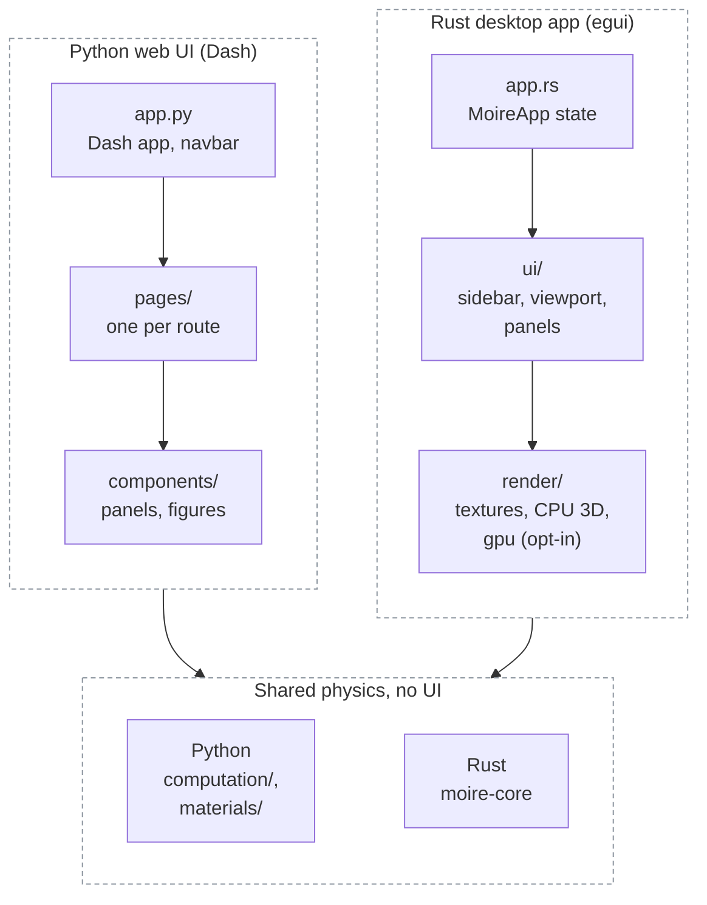
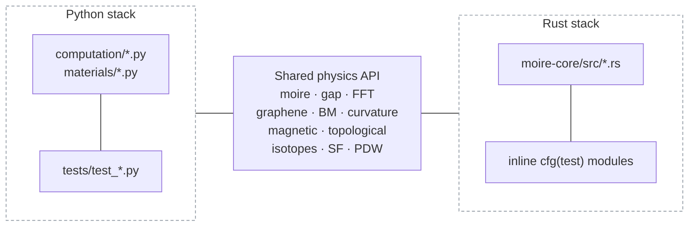
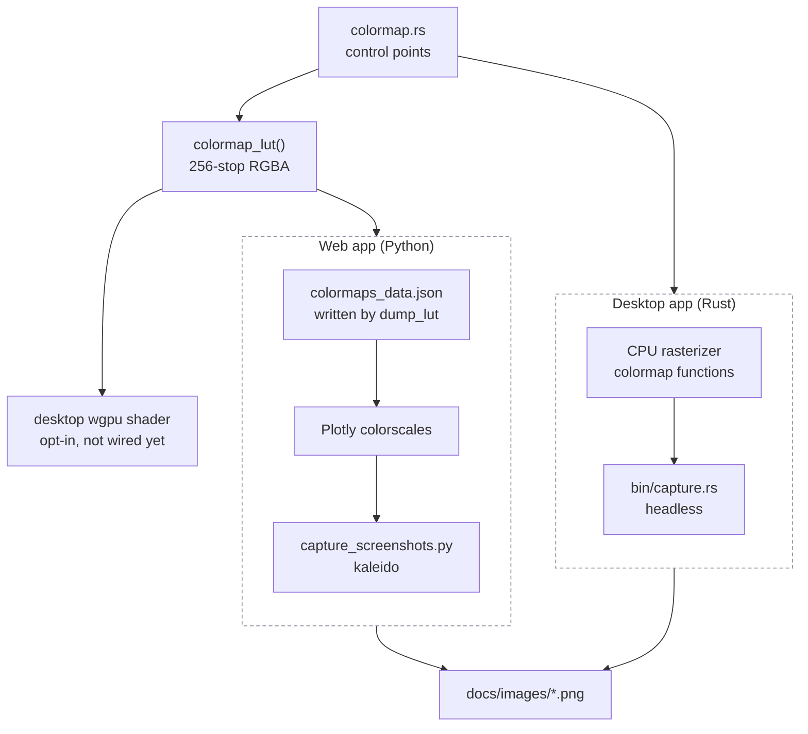
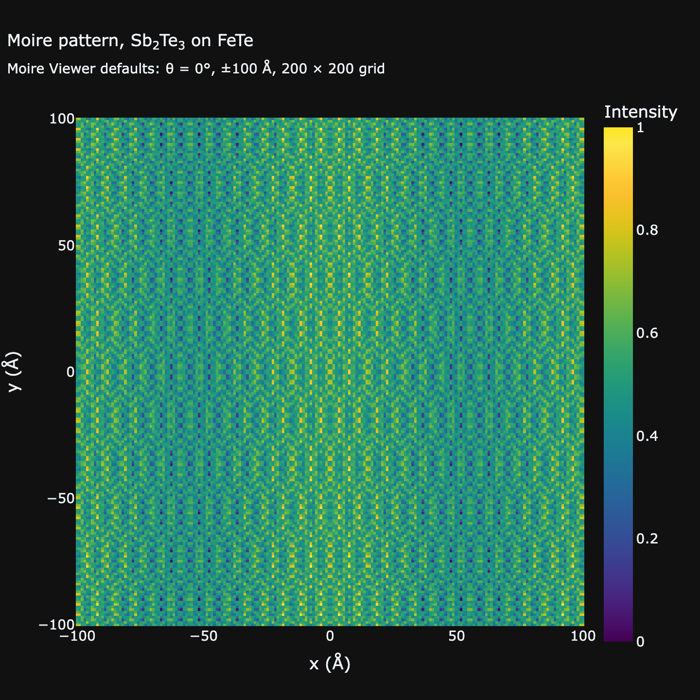
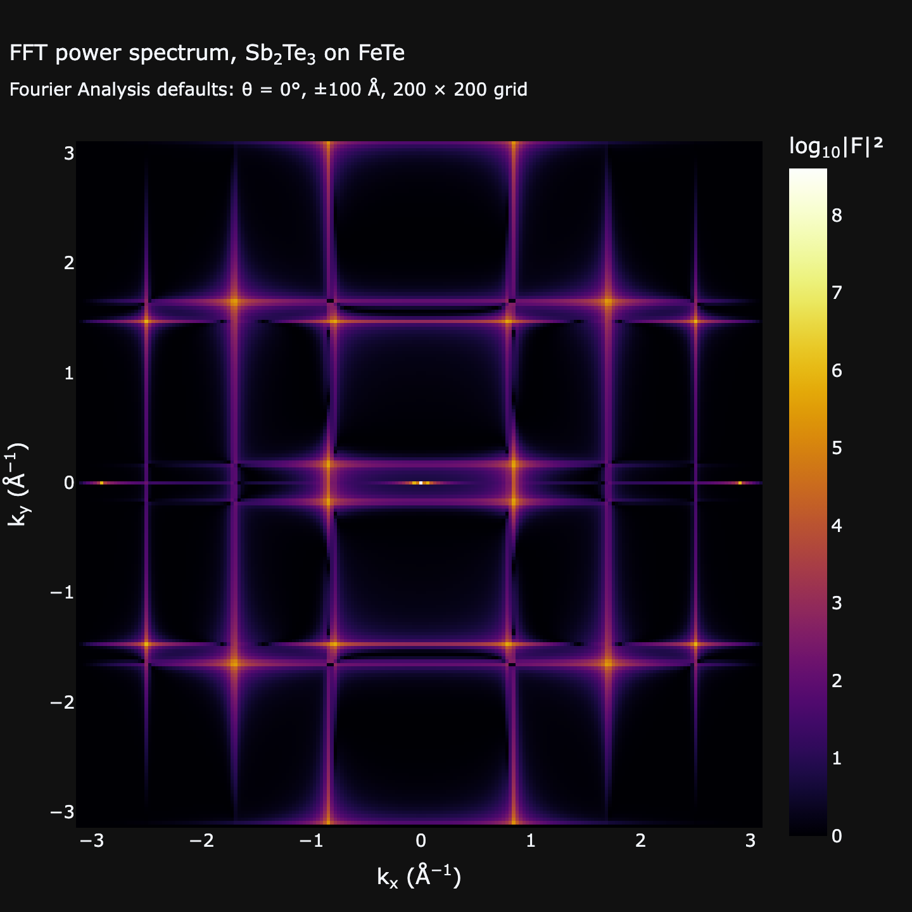
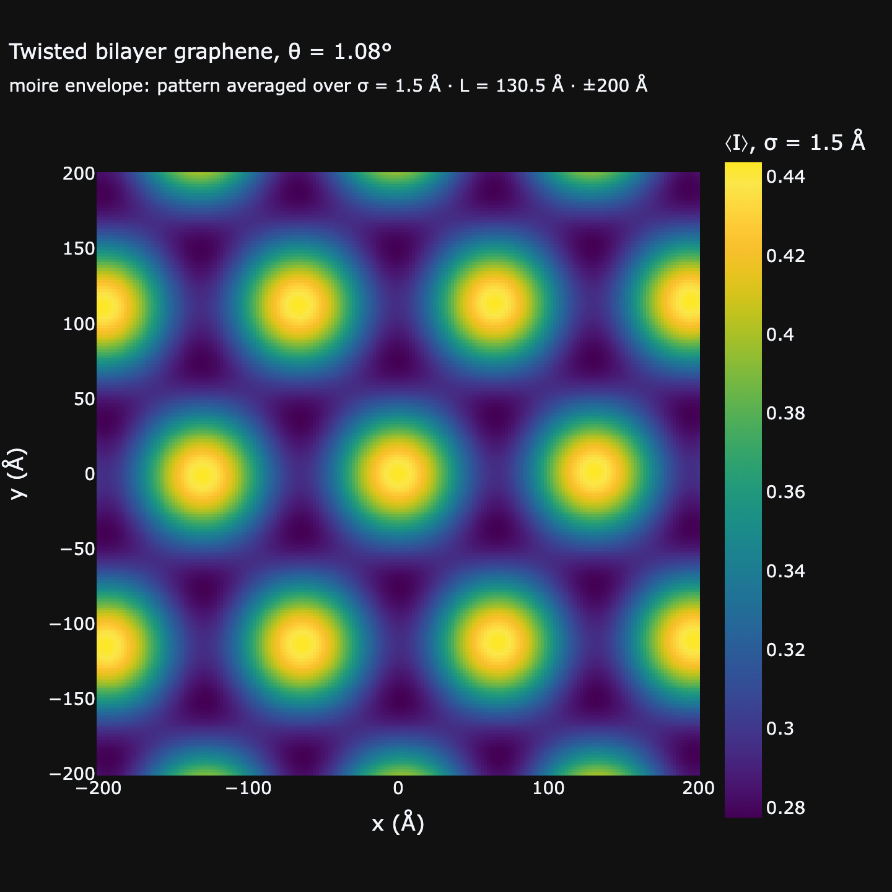

# Contributing to Good Job Coop

<sub>[Good Job Coop](README.md) › [Documentation](docs/README.md) · [Local setup](#local-setup) · [Architecture](#architecture) · [Physics sync](#keeping-python--rust-physics-in-sync) · [Screenshot capture](#screenshot-capture) · [Writing docs](#writing-docs) · [Testing](#testing)</sub>

*How to set up, change and document Good Job Coop: one physics core in two apps, kept in step by mirrored tests, regenerable figures and a checked docs style.*

Thanks for your interest! The project ships two implementations of the same physics: a Python web UI built on Plotly Dash and a Rust desktop app built on egui/eframe. Most physics changes therefore land in both stacks, and most visible changes also touch the docs and their figures. This guide covers the conventions that keep the two stacks, the figures and the docs in step.

## Local setup

```bash
git clone https://github.com/sonoransun/waytogocoop.git
cd waytogocoop

# Python 3.10+ (3.11+ recommended)
python -m venv .venv
source .venv/bin/activate          # Windows: .venv\Scripts\activate
pip install -e ".[dev]"            # also installs pytest, pytest-cov, ruff and kaleido
pytest tests/ -q
python -m waytogocoop.app          # web UI at http://localhost:8050

# Rust: a current stable toolchain from https://rustup.rs
cargo test                         # both crates
cargo run --release -p moire-desktop
```

- Run the commands in this guide from the repository root, with the virtual environment active.
- The desktop app runs on Linux (X11 or Wayland), macOS and Windows.
- Figure capture also needs a Chromium for kaleido, fetched once with `plotly_get_chrome -y` (see [Screenshot capture](#screenshot-capture)).

## Architecture

Both apps share one design: pure computation modules with no UI dependencies, implemented twice. The Python side computes with vectorized NumPy; the Rust side uses equivalent scalar loops. Each app wraps its own physics library in its UI.



The computation modules, in the docs' canonical order. Python paths are relative to `src/waytogocoop/`; Rust paths to `crates/moire-core/src/`.

| Module | Python | Rust | What it computes |
|---|---|---|---|
| Moire patterns | [`computation/moire.py`](src/waytogocoop/computation/moire.py) | [`moire.rs`](crates/moire-core/src/moire.rs) | Plane-wave superposition: the product of the two layer potentials |
| Gap modulation | [`computation/superconducting.py`](src/waytogocoop/computation/superconducting.py) | [`density.rs`](crates/moire-core/src/density.rs) | The gap field Δ(r) and the CPDM amplitude |
| Fourier analysis | [`computation/fourier.py`](src/waytogocoop/computation/fourier.py) | [`fft.rs`](crates/moire-core/src/fft.rs) | 2D FFT power spectrum and peak detection |
| Graphene stacks | [`computation/graphene.py`](src/waytogocoop/computation/graphene.py) | [`graphene.rs`](crates/moire-core/src/graphene.rs) | Stacking phases, heterostrain, supermoire, warp, magic angles; flat-band dome **(SPECULATIVE)** |
| BM model | [`computation/bm_model.py`](src/waytogocoop/computation/bm_model.py) | [`bm_model.rs`](crates/moire-core/src/bm_model.rs) | Momentum-lattice Hamiltonian, bands and DOS |
| Curvature | [`computation/curvature.py`](src/waytogocoop/computation/curvature.py) | [`curvature.rs`](crates/moire-core/src/curvature.rs) | Height fields, Monge-gauge strain, pseudo-field B<sub>ps</sub>; gap couplings **(SPECULATIVE)** |
| Magnetic field **(SPECULATIVE)** | [`computation/magnetic.py`](src/waytogocoop/computation/magnetic.py) | [`magnetic.rs`](crates/moire-core/src/magnetic.rs) | Vortex lattice, core suppression, Zeeman and Pauli limits, screening currents, moire–vortex beating |
| Topological proximity **(SPECULATIVE)** | [`computation/topological.py`](src/waytogocoop/computation/topological.py) | [`topological.rs`](crates/moire-core/src/topological.rs) | Proximity decay, 3D gap, Majorana modes, phase diagrams, Chern number |
| Isotope effects **(SPECULATIVE)** | [`computation/isotope_effects.py`](src/waytogocoop/computation/isotope_effects.py) | [`isotope_effects.rs`](crates/moire-core/src/isotope_effects.rs) | Lattice shift, BCS gap shift, Debye–Waller factor, spin fraction |
| Spin-fluctuation pairing **(SPECULATIVE)** | [`computation/spin_fluctuation.py`](src/waytogocoop/computation/spin_fluctuation.py) | [`spin_fluctuation.rs`](crates/moire-core/src/spin_fluctuation.rs) | LCCO Boltzmann magnetotransport (Γ(φ), Chambers ρ and MR, R<sub>H</sub> with CVCs), λ<sub>tr</sub> and λ<sub>ρ</sub>; empirical pairing map and moire glue what-if |
| Pair density waves **(SPECULATIVE)** | [`computation/pdw.py`](src/waytogocoop/computation/pdw.py) | [`pdw.rs`](crates/moire-core/src/pdw.rs) | Landau model: composite CDWs, d-vector rotation, regimes, sweeps |
| Material data | [`materials/database.py`](src/waytogocoop/materials/database.py) | [`materials.rs`](crates/moire-core/src/materials.rs) | Lattice constants, space groups, roles |
| Lattices | [`materials/lattice.py`](src/waytogocoop/materials/lattice.py) | [`lattice.rs`](crates/moire-core/src/lattice.rs) | Square and hexagonal lattice vectors, rotation, reciprocal vectors |
| Isotope data | [`materials/isotopes.py`](src/waytogocoop/materials/isotopes.py) | [`isotopes.rs`](crates/moire-core/src/isotopes.rs) | Masses, abundances, Debye temperatures, Grüneisen parameters |

## Repository layout

- `src/waytogocoop/`: the Python package.
  - `computation/`: pure NumPy physics, one module per physics row of the table above. No UI dependencies.
  - `materials/`: the material and isotope registries and lattice vectors.
  - `components/`: reusable Dash components (`figure_factory`, `controls`, the panels). `colormaps.py` and `colormaps_data.json` load the cross-stack colormap LUT.
  - `pages/`: one module per URL route, each calling `register_page()` at import.
  - `assets/`: CSS that Dash loads automatically (the responsive breakpoints live here).
  - `state.py`: URL state sharing (`encode_state`, `decode_state`, `register_url_sync`).
  - `config.py`: physical constants and defaults. `app.py`: the Dash app factory and navbar.
- `scripts/capture_screenshots.py`: the headless generator for the web-app docs figures.
- `scripts/check_docs.py`: the docs linter (see [Writing docs](#writing-docs)).
- `crates/moire-core/`: the Rust physics library (no UI dependencies), mirroring `computation/` and `materials/`.
  - `bin/dump_lut.rs`: regenerates `colormaps_data.json` from the Rust colormap tables.
- `crates/moire-desktop/`: the egui/eframe desktop app (library plus binaries).
  - `render/`: 2D and 3D rendering.
    - `surface3d.rs`: the CPU software rasterizer (default).
    - `renderer3d.rs`: the backend-agnostic `Renderer3D` trait and `FrameInputs`.
    - `gpu/`: wgpu pipeline scaffolding (opt-in `gpu` feature): `mod.rs`, `pipeline.rs`, `mesh.rs`, `camera.rs`, `readback.rs`, `shaders/surface.wgsl`, `shaders/volume.wgsl`.
    - `axes.rs`, `overlay.rs`, `pattern.rs`, `screenshot.rs`.
  - `ui/`: the sidebar, viewport, menu bar, About dialog, info panel, the isotope, magnetic, Cooper 3D, graphene, spin-fluctuation and PDW panels, the SF plots, and the phase-diagram window.
  - `app.rs`: the `MoireApp` recompute-on-change state machine.
  - `bin/capture.rs`: the headless generator for the desktop docs figures.
- `docs/`: the documentation; `docs/images/` holds the generated figures, and its README is the [Figure gallery](docs/images/README.md).
- `tests/`: the Python tests. Rust tests are inline `#[cfg(test)]` modules.

<details>
<summary><b>Full tree:</b> sources, tests, scripts and docs</summary>

```text
waytogocoop/
  README.md                         # Front door: what it is, quick start, gallery
  CONTRIBUTING.md                   # This guide
  LICENSE                           # MIT
  pyproject.toml                    # Python project config (dev extras, ruff, pytest)
  Cargo.toml                        # Rust workspace root

  docs/                             # Documentation (start at docs/README.md)
    README.md                       # Documentation hub
    physics-overview.md             # A short illustrated tour of the physics
    user-guide.md                   # Page-by-page guide to both apps
    materials.md                    # Materials and isotope database
    glossary.md                     # Term definitions (term-* anchors)
    references.md                   # Annotated bibliography (ref-* anchors)
    history.md                      # How the research threads developed
    process-technologies.md         # MBE, STM/STS, enrichment, graphene fabrication
    theory/                         # Theory index plus one page per physics module
    images/                         # Generated figures; README.md is the Figure gallery

  scripts/
    capture_screenshots.py          # Web-app docs figures (Plotly + kaleido, headless)
    check_docs.py                   # Docs linter: style, links, anchors and images

  src/waytogocoop/                  # Python web UI
    app.py                          # Dash entry point (create_app factory, navbar)
    config.py                       # Physical constants and defaults
    state.py                        # URL state sharing (?q=<base64>)
    assets/                         # CSS
    materials/
      database.py                   # Material registry: FeTe, tellurides, graphene
      lattice.py                    # Square and hexagonal lattice vectors
      isotopes.py                   # Isotope masses, abundances, spin fractions (AME2020)
    computation/
      moire.py                      # Plane-wave moire pattern generation
      superconducting.py            # Gap modulation and CPDM amplitude
      fourier.py                    # 2D FFT and peak detection
      graphene.py                   # Stacking, heterostrain, supermoire, magic angles
      bm_model.py                   # Bistritzer–MacDonald bands and DOS
      curvature.py                  # Height fields, Monge strain, pseudo-field
      magnetic.py                   # Vortex lattice, Zeeman, screening, beating
      topological.py                # Proximity decay, Majorana modes, phase diagrams
      isotope_effects.py            # Isotope effects (speculative)
      spin_fluctuation.py           # LCCO magnetotransport, pairing what-ifs (speculative)
      pdw.py                        # Pair-density-wave Landau model (speculative)
    pages/                          # One module per route
      home.py                       # /             landing page, materials, About
      moire_viewer.py               # /viewer       moire and gap viewer, isotope card
      parameter_sweep.py            # /sweep        lattice and twist sweeps
      fourier_analysis.py           # /fourier      reciprocal-space analysis
      substrate_comparison.py       # /comparison   overlayers side by side on FeTe
      graphene.py                   # /graphene     stacks, BM bands and DOS, curvature
      magnetic_field.py             # /magnetic     vortices, screening, Majoranas
      proximity_3d.py               # /proximity3d  3D proximity gap views
      phase_diagram.py              # /phase        topological phase diagram sweeps
      spin_fluctuation.py           # /spinfluct    LCCO magnetotransport, glue what-if
      pair_density_wave.py          # /pdw          PDW modalities, sweeps, regime map
    components/
      material_selector.py          # Material dropdowns
      parameter_panel.py            # Slider controls
      isotope_panel.py              # Isotope enrichment controls
      magnetic_panel.py             # Magnetic field and proximity controls
      graphene_panel.py             # Graphene controls and figure builders
      sf_panel.py                   # Spin-fluctuation transport, pairing and glue controls
      pdw_panel.py                  # PDW geometry, temperature, field and coupling controls
      controls.py                   # Shared control builders
      figure_factory.py             # Plotly figure builders
      colormaps.py                  # Cross-stack colormap LUT loader
      colormaps_data.json           # 256-stop RGB LUTs (generated by dump_lut)

  crates/
    moire-core/                     # Rust physics library (no UI deps)
      src/
        materials.rs                # Material database
        lattice.rs                  # Lattice2D type and generation
        moire.rs                    # MoireConfig -> MoireResult
        density.rs                  # Cooper-pair density modulation
        fft.rs                      # 2D FFT via rustfft
        graphene.rs                 # Stacking, heterostrain, supermoire, magic angles
        bm_model.rs                 # Bistritzer–MacDonald bands and DOS
        curvature.rs                # Height fields, Monge strain, pseudo-field
        magnetic.rs                 # Vortex lattice, Zeeman, screening, beating
        topological.rs              # Proximity decay, Majorana modes, phase diagrams
        isotopes.rs                 # Isotope data and spin fractions
        isotope_effects.rs          # Isotope effects (speculative)
        spin_fluctuation.rs         # LCCO magnetotransport, pairing what-ifs (speculative)
        pdw.rs                      # Pair-density-wave Landau model (speculative)
        colormap.rs                 # viridis, inferno, coolwarm and plasma LUTs
        bin/dump_lut.rs             # Regenerates components/colormaps_data.json
    moire-desktop/                  # Rust egui/eframe desktop app
      src/
        main.rs, lib.rs             # Binary entry point and library root
        app.rs                      # MoireApp state, recompute-on-change
        bin/capture.rs              # Desktop docs figures (headless CPU rendering)
        ui/
          sidebar.rs                # Material and parameter controls, colormap override
          viewport.rs               # Tab bar, 2D/3D toggle, textures, FFT peak table
          info_panel.rs             # Computed results
          isotope_panel.rs          # Isotope enrichment controls
          magnetic_panel.rs         # Magnetic field controls and view selector
          cooper_panel.rs           # Cooper 3D views and z-sweep animation
          graphene_panel.rs         # Graphene stack and curvature controls
          sf_panel.rs               # Spin Fluctuations controls, presets and readouts
          sf_plots.rs               # Spin Fluctuations transport and imprint plots
          pdw_panel.rs              # Pair Density Wave controls and palette
          phase_window.rs           # Topological phase-diagram window
          menu.rs, about.rs         # Menu bar; About and physics reference
        render/
          pattern.rs                # 2D colormap textures
          surface3d.rs              # CPU 3D surface rasterizer (Camera3D)
          renderer3d.rs             # Renderer3D trait: CPU and GPU backends
          overlay.rs, axes.rs       # Vortex markers; world axes and scale bar
          screenshot.rs             # PNG export
          gpu/                      # Opt-in wgpu pipeline and WGSL shaders

  tests/                            # Python tests; Rust tests are inline modules
    conftest.py
    test_materials.py  test_moire.py  test_superconducting.py  test_fourier.py
    test_graphene.py  test_bm_model.py  test_curvature.py  test_magnetic.py
    test_topological.py  test_topological_3d.py  test_isotopes.py
    test_spin_fluctuation.py  test_spin_fluctuation_page.py  test_pdw.py
    test_figure_factory.py  test_capture_parity.py
```

</details>

## <a id="keeping-python--rust-physics-in-sync"></a>Keeping Python and Rust physics in sync

> [!IMPORTANT]
> **Both stacks, one PR.** A change to a physics kernel lands in Python and in Rust in the same PR, with tests on each side that exercise the same inputs.

The test suites mirror each other module by module: `tests/test_moire.py` ↔ the inline tests in `crates/moire-core/src/moire.rs`, and so on down the table in [Architecture](#architecture). Where an exact number matters, both suites pin the same value (a parity anchor, for example `TestCrossStackParityAnchors` in `tests/test_pdw.py`); change it in both languages or not at all.



**Colormap convention** (identical in both stacks): `viridis` for unsigned scalars such as the moire pattern; `coolwarm` for signed and gap-valued fields, running from low = blue to high = red (Python builders may ask for it as `"RdBu_r"`); `inferno` for FFT power spectra; `plasma` for susceptibility. See `crates/moire-core/src/colormap.rs`, `src/waytogocoop/components/figure_factory.py` and [Rendering pipeline](#rendering-pipeline).

## Adding a material

A new material lands in both stacks in the same PR. The two registries:

| Registry | Python | Rust |
|---|---|---|
| Materials | [`materials/database.py`](src/waytogocoop/materials/database.py): `MATERIALS`, `get_material`, `list_materials` | [`materials.rs`](crates/moire-core/src/materials.rs): `MATERIALS`, `by_name`, `substrates`, `overlayers` |
| Isotopes | [`materials/isotopes.py`](src/waytogocoop/materials/isotopes.py): `ELEMENTS`, `MATERIAL_COMPOSITION` | [`isotopes.rs`](crates/moire-core/src/isotopes.rs): per-element tables such as `FE_ISOTOPES`, `material_composition` |

1. **Python:** add a `Material` entry to `MATERIALS` in `src/waytogocoop/materials/database.py`. The dataclass validates `a > 0`, `c >= 0`, `lattice_type` in `{"hexagonal", "square"}` and `role` in `{"substrate", "overlayer", "both"}`. The web dropdowns pick it up through `list_materials(role=...)`.
2. **Rust:** mirror the entry, with identical numbers, in the `static MATERIALS` slice in `crates/moire-core/src/materials.rs`. The desktop dropdowns pick it up through `substrates()` and `overlayers()`.
3. **Isotope support** (needed by the isotope panel): add the composition to `MATERIAL_COMPOSITION` in `isotopes.py` and to `material_composition` in `isotopes.rs`, and add any new element to `ELEMENTS` and to the Rust isotope tables, with AME2020 masses and abundances.
4. **Tests, both sides:** update the count assertions and add a property test: `test_materials_count` in `tests/test_materials.py`, and `test_all_materials_count` plus the role-filter tests such as `test_overlayers_count` in the inline `#[cfg(test)]` module of `materials.rs`.
5. **Comparison views:** the desktop **Compare All Substrates** window lists every overlayer in the registry, but the web **Substrate Comparison** page shows a fixed list (`_OVERLAYER_FORMULAS` in `pages/substrate_comparison.py`). If the new material belongs there, add it, and update the capture script's copy (`_COMPARISON_OVERLAYERS`), which `tests/test_capture_parity.py` checks.
6. **Docs:** add the material, with its isotopes, to [Materials](docs/materials.md).

[Isotope effects](docs/theory/isotope-effects.md) explains what the isotope data feeds into; [Process technologies](docs/process-technologies.md) covers growth and enrichment.

## Adding a figure or tab

**Python:** add a builder function to `components/figure_factory.py`, then wire it into the page under `pages/`. A new page also needs an entry in the `NAVBAR` table in `app.py`: a plain link, or a `(label, href)` item in the **Core** or **Speculative** dropdown menu (`tests/test_app.py` pins the table). Builders should:

- accept explicit x and y arrays in Å (k-space arrays in Å⁻¹ for FFTs);
- set `xaxis_title` and `yaxis_title` with unit symbols;
- include a `hovertemplate` with unit-labelled fields;
- give real-space heatmaps a strict 1:1 aspect with `yaxis=dict(scaleanchor="x", scaleratio=1, constrain="domain")`;
- pick colormaps by the [colormap convention](#keeping-python--rust-physics-in-sync);
- respect the `dark: bool` theme parameter.

**Rust:** add a `Tab` variant in `app::Tab`, handle it in `ui/viewport.rs::view_meta` (axis and colorbar metadata) and in `app::recompute` and `app::rerender_surface` (which texture to draw).

**Docs figures:** a figure embedded in any page needs a capture scene and a Figure gallery entry. See [Screenshot capture](#screenshot-capture) and [Figures](#figures).

## Rendering pipeline

Both apps color their fields from one set of colormaps, so the two stacks use identical colormaps; the layout, lighting and resolution of their views still differ.

- **Shared colormap LUT.** `colormap_lut()` in `crates/moire-core/src/colormap.rs` samples each colormap into a 256-stop RGBA table. `cargo run -p moire-core --bin dump_lut` writes the tables to `src/waytogocoop/components/colormaps_data.json`, which `components/colormaps.py` loads for Plotly. The desktop CPU path calls the same colormap functions directly, and the opt-in wgpu shader samples the LUT as a `texture_2d<f32>`. `TestColormapLutParity` in `tests/test_topological_3d.py` catches drift.
- **Web 3D (Plotly, WebGL).** `go.Mesh3d` draws dense surfaces, `go.Volume` renders the proximity gap Δ(x, y, z) volumetrically, `go.Cone` draws 3D screening-current quivers, and `go.Isosurface` draws nested gap shells. On **3D Proximity** (`/proximity3d`) the **Iso-level range (fraction of peak Δ)** slider, the **▶ Play iso sweep** button and the **Clip plane (z, Å) — ∞ disables** slider drive them. Every page with controls syncs its state to the URL through `register_url_sync`, so any view can be shared as `?q=<base64>`.
- **Desktop 3D.** The default build draws 3D surfaces with the CPU software rasterizer (`render/surface3d.rs`) behind the backend-agnostic `Renderer3D` trait (`render/renderer3d.rs`). The opt-in `gpu` cargo feature (`cargo build -p moire-desktop --features gpu`) compiles a wgpu pipeline in `render/gpu/`: a WGSL surface shader with Lambert diffuse, Blinn–Phong specular and Fresnel–Schlick terms, a volumetric raymarch stub, and a readback path. The app does not drive it yet; see [Future work](#future-work).
- **Clip plane.** On the web, the clip slider drops the z-layers above the plane. On the desktop, the sidebar **Clip plane** checkbox and slider set `FrameInputs::clip_z`; the WGSL shader discards fragments above it, but the CPU rasterizer ignores it for now, so the default build draws the whole surface.



Regenerate the docs figures after any visual change: see [Screenshot capture](#screenshot-capture).

## Screenshot capture

Every image in `docs/images/` is generated by a capture scene, and the [Figure gallery](docs/images/README.md) holds each image's canonical caption in its [Inventory](docs/images/README.md#inventory). Two generators share the folder:

- **Web (Python):** [`scripts/capture_screenshots.py`](scripts/capture_screenshots.py) builds the app-view figures with the app's own `figure_factory` builders (docs-only and some presentation scenes plot app physics directly) and exports every figure through kaleido, with no Dash server. One-time setup: `plotly_get_chrome -y`. Its `SCENES` registry holds `Scene(filename, build, frame, kind, step)` entries.
- **Desktop (Rust):** [`crates/moire-desktop/src/bin/capture.rs`](crates/moire-desktop/src/bin/capture.rs) draws with the app's own code paths (the CPU rasterizer for 3D views, a CPU copy of the texture draw for 2D views), so it needs no window or GPU. Its `SCENES` array holds `Scene { name, filename, kind, build }` entries.

```bash
python scripts/capture_screenshots.py                  # every web scene
python scripts/capture_screenshots.py --list           # name, file, frame, kind, size
python scripts/capture_screenshots.py --only fourier,pdw-fft
cargo run -p moire-desktop --bin capture --release     # every desktop scene
cargo run -p moire-desktop --bin capture --release -- --list
cargo run -p moire-desktop --bin capture --release -- --only rust-desktop-2d,rust-density-3d
```

- `--only` takes a comma list and may repeat; an unknown scene name is an error. `--out-dir DIR` writes somewhere else. Both generators default to the repository's `docs/images`, whatever the working directory, and the Rust binary needs `--` before its own flags.
- Both print each file's size, warn above the 800 KB soft cap per PNG, and report the folder total against the 12 MB budget. Both refuse to write a PNG with transparent pixels.

### Frames and kinds

| Frame | PNG (px) | Use for |
|---|---|---|
| Wide | 1600 × 1000 | line plots, sweeps, bands, (B, T) maps, every Plotly 3D scene |
| Square | 1440 × 1440 | equal-aspect real-space and k-space maps |
| Rust | 1024 × 1024 | every desktop capture |

Plotly figures are laid out at 800 × 500 (Wide) or 720 × 720 (Square) and exported at 2× scale, so their text stays legible when a card shows the PNG at half width. Every scene has one of three kinds:

- **App view** (`app`): the app's own figure at settings a user can reach. The caption states any non-default setting.
- **Presentation** (`presentation`): app physics plus exactly one named display step, such as a local average, a local RMS contrast, a clipped color range or overlaid peaks. Python scenes name it in `step`, and the caption names it too.
- **Docs-only** (`docs-only`, web registry): a plot of app physics that neither app draws.

Python's `_docs_style()` gives every web figure its frame size, 14 px text, 17 px left-aligned titles, the opaque `plotly_dark` template and a fixed 3D camera, and removes the app's camera buttons. Desktop captures sit on the app's dark background, RGB (30, 30, 35). Desktop extents are full widths and web extents half-widths: a desktop extent of 200 Å matches the web's ±100 Å window.

### Adding a docs figure

1. Add a scene to the registry in canonical page order (core pipeline, graphene track, speculative extensions). Its name is the file stem; desktop scene names start with `rust-`. Keep the file name a literal string (`"name.png"` in Python, `filename: "name.png"` in Rust), because `check_docs.py` reads it.
2. Pick the frame and declare the kind; a presentation scene names its step.
3. Keep the app's `(SPECULATIVE)` title tag on figures from speculative modules, and use the docs [typography](#typography-and-headings) in titles and axis labels.
4. Render it with `--only`, look at it, and check its size. A PNG over the 800 KB soft cap needs its size and the reason in its Inventory row.
5. Add a row to the Figure gallery's Inventory, with the PNG's file name in the first cell and its canonical caption. Captions on other pages must agree with it. `check_docs.py` fails on a PNG without a scene or without an Inventory row.
6. If the scene copies a page preset or callback logic (the page modules cannot be imported without an app), add a check to `tests/test_capture_parity.py`.

### Determinism

With one toolchain on one machine (plotly 7.1.0, kaleido 1.5.0 and its Chromium, the OS fonts, rustc 1.99.1 and the png 0.17 crate), two runs write byte-identical PNGs. Regenerate the whole set on one machine and commit it together; on another machine, compare visually. To check:

```bash
T=$(mktemp -d)
for run in a b; do
  python scripts/capture_screenshots.py --out-dir "$T/$run"
  cargo run -q -p moire-desktop --bin capture --release -- --out-dir "$T/$run"
  (cd "$T/$run" && shasum -a 256 *.png) > "$T/$run.sha256"
done
diff "$T/a.sha256" "$T/b.sha256" && echo deterministic
```

This prints nothing when every PNG has a scene and every scene has a PNG:

```bash
comm -3 <(ls docs/images/*.png | xargs -n1 basename | sort) <(
  { python scripts/capture_screenshots.py --list
    cargo run -q -p moire-desktop --bin capture --release -- --list; } | cut -f2 | sort)
```

The running apps export equivalent images on demand: the camera button in a web figure's toolbar, or <kbd>Ctrl</kbd>+<kbd>S</kbd> (<kbd>⌘</kbd>+<kbd>S</kbd> on macOS) in the desktop app, which writes a timestamped PNG to the working directory through `render::screenshot::save_color_image_to_png`. Those exports are not docs figures, because no scene can regenerate them.

## Writing docs

These rules keep the root README, this guide and everything under `docs/` consistent and readable on github.com in light and dark mode. GitHub is the only renderer the docs target: GitHub-flavored Markdown plus the HTML that GitHub keeps, with no custom CSS or scripts. [`scripts/check_docs.py`](scripts/check_docs.py) checks almost everything below; run it before you open a PR (see [Checking your changes](#checking-your-changes)).

### Page map

Each page has one link text, used in every list, nav line, footer and table, and one H1. Link text is sentence case; H1s are Title Case. The theory pages, in canonical order:

| # | Track | Link text | H1 | Status |
|--:|---|---|---|---|
| 1 | Core pipeline | [Moire patterns](docs/theory/moire-patterns.md) | Moire Patterns | Validated |
| 2 | Core pipeline | [Gap modulation](docs/theory/gap-modulation.md) | Gap Modulation and the CPDM State | Validated |
| 3 | Core pipeline | [Fourier analysis](docs/theory/fourier-analysis.md) | Fourier Analysis | Validated |
| 4 | Graphene track | [Graphene stacks](docs/theory/graphene-stacks.md) | Graphene Stacks | Mixed |
| 5 | Graphene track | [BM model](docs/theory/bm-model.md) | The Bistritzer–MacDonald Model | Validated |
| 6 | Graphene track | [Curvature](docs/theory/curvature.md) | Curvature and Pseudo-Magnetic Fields | Mixed |
| 7 | Speculative extensions | [Magnetic field](docs/theory/magnetic.md) | Magnetic Field Effects | **Speculative** |
| 8 | Speculative extensions | [Topological proximity](docs/theory/topological.md) | Topological Proximity and Majorana Modes | **Speculative** |
| 9 | Speculative extensions | [Isotope effects](docs/theory/isotope-effects.md) | Isotope Effects | **Speculative**; exotic tier **Highly speculative** |
| 10 | Speculative extensions | [Spin-fluctuation pairing](docs/theory/spin-fluctuation-pairing.md) | Spin-Fluctuation Pairing | **Speculative** |
| 11 | Speculative extensions | [Pair density waves](docs/theory/pair-density-waves.md) | Pair Density Waves | **Speculative** |

The other pages:

| Group | Link text | File | H1 |
|---|---|---|---|
| Front door | [Good Job Coop](README.md) | `README.md` | Good Job Coop! |
| Hub | [Documentation](docs/README.md) | `docs/README.md` | Good Job Coop Documentation |
| Learn | [Physics overview](docs/physics-overview.md) | `docs/physics-overview.md` | Physics Overview |
| Learn | [Theory index](docs/theory/README.md) | `docs/theory/README.md` | Theory Index |
| Use | [User guide](docs/user-guide.md) | `docs/user-guide.md` | User Guide |
| Look up | [Materials](docs/materials.md) | `docs/materials.md` | Materials and Isotope Database |
| Look up | [Glossary](docs/glossary.md) | `docs/glossary.md` | Glossary |
| Look up | [References](docs/references.md) | `docs/references.md` | References |
| Look up | [Figure gallery](docs/images/README.md) | `docs/images/README.md` | Figure Gallery |
| Context | [History](docs/history.md) | `docs/history.md` | History |
| Context | [Process technologies](docs/process-technologies.md) | `docs/process-technologies.md` | Process Technologies |
| Contribute | [Contributing guide](CONTRIBUTING.md) | `CONTRIBUTING.md` | Contributing to Good Job Coop |

- Every list of theory pages uses the order above: At a glance in the root README, Learn in Documentation, the Theory index's map, tables and code map, the pagers, the Figure gallery groups, the history recap, and the glossary and references sections.
- Retired names, never used as link text or headings: `Theory overview`, `Theory Documentation`, `Documentation index`, `Historical context`, `Topological` on its own, `Materials & isotope database`, `docs/images`, `Project README`.

### Status labels and alerts

Every physics module has one status, shown as a GitHub alert on its pages:

| Label | Meaning | Alert | Mermaid class | In a table |
|---|---|---|---|---|
| Validated | Established physics, cross-checked by mirrored Python and Rust tests | `[!NOTE]` | none | Validated |
| Mixed | A validated core with named speculative components | `[!WARNING]` | `mixed` | Mixed |
| Speculative | A simplified model not validated for these heterostructures | `[!WARNING]` | `spec` | **Speculative** |
| Highly speculative | Hypothetical inputs beyond the speculative tier: synthetic and exotic isotopes | `[!CAUTION]` | `hispec` | **Highly speculative** |

**Never milder than the app.** A label is at least as cautious as the stricter of the two in-app About panels (web [`pages/home.py`](src/waytogocoop/pages/home.py), desktop [`ui/about.rs`](crates/moire-desktop/src/ui/about.rs)). Both list the vortex lattice with its Zeeman and Pauli limits, and the Majorana modes, as speculative, so Magnetic field and Topological proximity are Speculative; their alerts say which formulas are textbook. Graphene stacks and Curvature (Mixed) and the BM model (Validated) appear in neither panel: the docs assign those labels, and the [Theory index](docs/theory/README.md#status-labels) says so once.

The status alert, with the marker alone on its line and the status on the next:

```markdown
> [!WARNING]
> **Status: Speculative.** <Why, in 60 words or fewer.>
```

- **Status alerts** (NOTE, WARNING, CAUTION) carry status only. The second line starts with `**Status: <Label>.**` and says why in 60 words or fewer (no direct data, borrowed parameters, a phenomenological model), with no lists or images. A Mixed alert names its speculative parts and links to them. A Speculative alert usually ends with "Treat outputs as exploratory illustrations, not quantitative predictions."
- **Other alerts:** at most one `[!IMPORTANT]` per page, a caveat that changes how a result must be read, opening with a bold label that is not a status (`**Scale estimate only.**`); and at most one `[!TIP]`, opening with a bold label such as `**Try it:**` or `**New here?**`.
- **Limits:** at most three alerts per page (the user guide is exempt), never two in a row, and never inside a list, a table or `<details>`, where GitHub shows a plain quote instead.
- **Placement:** a theory page has one status alert, after its dek. A section gets its own alert only when its tier is above the page's: the Speculative components of a Mixed page, or the exotic isotopes on Isotope effects. The user guide gives each web-page section that is not Validated its own alert, and Materials gives its synthetic isotopes a CAUTION. The README, the hubs, the glossary, references, history and process technologies use status columns and inline flags instead.
- **Inline flag:** right after a speculative item's name, write `**(SPECULATIVE)**` or `**(HIGHLY SPECULATIVE)**`; inside HTML, `<b>(SPECULATIVE)</b>`. Captions of figures from speculative modules, or from the speculative parts of Mixed modules, end with it. To quote the apps' own title tag, use code: `` `(SPECULATIVE)` ``. Never put a tag in a heading, and never use other forms such as `(spec.)`, `(Speculative)`, `SPECULATIVE --`, `Status: mixed.`, `CAVEAT —` or `Status note:`.
- **Asides** are plain quotes that open with a bold label, never alerts: `> **Convention.**`, `> **Erratum.**`, `> **Provenance.**`, `> **Implementation note.**` and `> **In this codebase — Modeled.**` (or Simulated analog, Partially modeled, Context only, Speculative). References, history and process technologies each carry one Provenance aside instead of scattered hedges.

### Page furniture

Every page opens with its H1, a `<sub>` nav line on line 3, and an italic one-sentence dek. A theory page follows the dek with its status alert and a **Builds on** · **In the apps** line.

- **Documentation:** `[← Good Job Coop](../README.md)`
- **Physics overview and User guide:** `[Good Job Coop](../README.md) › [Documentation](README.md)`; the user guide appends jump links to its main sections.
- **Theory index and Figure gallery:** `[Good Job Coop](../../README.md) › [Documentation](../README.md)`; the gallery appends the Look-up switcher.
- **Theory pages:** `[Good Job Coop](../../README.md) › [Documentation](../README.md) › [Theory index](README.md) · Core pipeline · 2 of 11`
- **Look-up pages:** `[Good Job Coop](../README.md) › [Documentation](README.md) · Look up: [Materials](materials.md) · **Glossary** · [References](references.md) · [Figure gallery](images/README.md)`. The switcher lists its pages in page-map order, with the current page bold and unlinked in its own place, so every page shows the same order.
- **Context pages:** the same pattern and rule: `Context: **History** · [Process technologies](process-technologies.md)` on History, and `Context: [History](history.md) · **Process technologies**` on Process technologies.

Every page ends with a footer after a `---` rule, with a blank line above the rule:

- **Theory pages:** `**Related:**` with two to four links, each with a short reason; `**Terms:**` with glossary section links; then a one-line pager, `[← Moire patterns](moire-patterns.md) · [Theory index](README.md) · [Fourier analysis →](fourier-analysis.md)`. The first page has no previous link and the last no next link. The pager is never a table, because GitHub draws tables as small bordered boxes.
- **Documentation:** `**Next:** [User guide](user-guide.md) · [Physics overview](physics-overview.md)`
- **Physics overview:** `**Next:** [Theory index](theory/README.md) → [Moire patterns](theory/moire-patterns.md) · **Use it:** [User guide](user-guide.md) · **Look up:** [Glossary](glossary.md) · [References](references.md)`
- **Theory index:** `**Start reading:** [Moire patterns →](moire-patterns.md) · [Physics overview](../physics-overview.md) · [Glossary](../glossary.md) · [References](../references.md)`
- **User guide:** `**Where next:** [Physics overview](physics-overview.md) · [Theory index](theory/README.md) · [Figure gallery](images/README.md) · [↑ Top](#user-guide)`
- **Look-up pages** repeat their nav line at full size. **Context pages** add `**Next:** [Physics overview](physics-overview.md)`; Process technologies uses `**Next:** [Materials](materials.md)` instead.

### Theory pages

Every theory page follows one template; [Gap modulation](docs/theory/gap-modulation.md) is the reference implementation.

- The H2s are exactly these, in this order, leaving out any that do not apply: Overview · Model · Speculative components · Assumptions and validity · Implementation · References. Everything else is an H3.
- Speculative components appears only when the page has some, always before Assumptions and validity, and opens with its own alert when its tier is above the page's.
- Implementation holds a `| Concept | Python | Rust |` table of clickable source links, with the base directories stated once above it. Maintainer detail goes below it in a `<details>`: parity anchors, solver internals, border clamps, error types and cross-language differences.
- No free-standing status prose and no lists of related theory pages: the alert and the footer carry them.

The skeleton, ready to copy:

~~~markdown
# Gap Modulation and the CPDM State

<sub>[Good Job Coop](../../README.md) › [Documentation](../README.md) › [Theory index](README.md) · Core pipeline · 2 of 11</sub>

*How the moire pattern becomes a spatially modulated superconducting gap Δ(r), and why the modulation fades when Cooper pairs are larger than the moire.*

> [!NOTE]
> **Status: Validated.** BCS-style gap modulation with moire amplitude scaling, cross-checked by mirrored Python and Rust tests. The field-tunable CPDM built on it is speculative ([Magnetic field](magnetic.md#speculative-components)).

**Builds on** [Moire patterns](moire-patterns.md) · **In the apps** web [`/viewer`](../user-guide.md#viewer), [`/comparison`](../user-guide.md#comparison), [`/sweep`](../user-guide.md#sweep) · desktop **Density Modulation** tab

## Overview

(Narrative. Link the first use of up to six glossary terms, such as [CPDM](../glossary.md#term-cpdm). Then a figure card.)

### CPDM versus PDW

## Model

### (one H3 per topic)

## Speculative components

(Only when present. Its own alert when its tier is above the page's.)

## Assumptions and validity

## Implementation

Python paths are relative to `src/waytogocoop/`; Rust paths to `crates/moire-core/src/`.

| Concept | Python | Rust |
|---|---|---|
| Gap field Δ(r) | [`computation/superconducting.py`](../../src/waytogocoop/computation/superconducting.py) · `gap_modulation` | [`density.rs`](../../crates/moire-core/src/density.rs) · `compute_density_modulation` |

<details>
<summary><b>Cross-language notes:</b> parity anchors and edge cases</summary>

(Maintainer detail.)

</details>

## References

- [Wang et al., *Nature* 652, 335 (2026)](../references.md#ref-wang-2026) — the heterostructure and its two modulated gaps.

---

**Related:** [Pair density waves](pair-density-waves.md) — the spontaneous cousin of a CPDM · [Magnetic field](magnetic.md) — vortex cores punch holes in Δ(r) · [Isotope effects](isotope-effects.md) — isotope mass rescales Δ

**Terms:** [Superconductivity](../glossary.md#superconductivity) · [Modulated pairing](../glossary.md#modulated-pairing)

[← Moire patterns](moire-patterns.md) · [Theory index](README.md) · [Fourier analysis →](fourier-analysis.md)
~~~

### Adding a theory page

A new theory page touches more than its own file. Update all of these in the same PR:

1. the page itself, from the skeleton above, with its status alert and footer;
2. the [Theory index](docs/theory/README.md): the page's row in its track table, the [module map](docs/theory/README.md#module-map) and the [code map](docs/theory/README.md#code-map);
3. the pagers of both neighbors, and the "n of N" count in every theory nav line if the total changes;
4. **Learn** in [Documentation](docs/README.md);
5. **At a glance** on the front page, [Good Job Coop](README.md);
6. the [Physics overview](docs/physics-overview.md);
7. the Figure gallery groups, the glossary and references sections and the user guide's theory links, where the page adds entries;
8. `THEORY_ORDER` in `scripts/check_docs.py`, which checks every pager.

### Math

- **Display math** goes only in a ```` ```math ```` fence, one equation or one `aligned` block per fence. Never `$$`: GitHub applies Markdown first, so a line that starts with `+` or `-` becomes a list item, and `\,` `\!` `\{` `\%` lose their backslash.
- **Inline math** is only `` $`…`$ ``. Never a bare `$…$` (underscores in two spans pair up into italics), `\(…\)` or `\[…\]`. A literal dollar sign is `<span>$</span>`.
- Inside math, write `\lt` and `\gt`, never `<` or `>`; `^\circ` for degrees; `\text{…}` for words. In a table cell write `\lvert x \rvert` (and `\lVert x \rVert`), because a `|` splits the cell.
- Symbols in prose are math while values and units stay text: $`\theta`$ = 1.08°. Single symbols may stay Unicode (θ, Δ₁, ξ). An inline formula longer than about 40 characters goes in a fence.
- Where math cannot render, write Unicode (Δ₁, ξ, Å⁻¹) or `<sub>`/`<sup>`: headings, table headers, Mermaid labels, HTML cards, alt text and `<summary>`.
- Write one source line per paragraph and never hard-wrap, so no math span straddles a line break.

````markdown
The gap field is

```math
\Delta(\mathbf{r}) = \Delta_{\text{avg}} + \delta\Delta\,\cos(\mathbf{Q}\cdot\mathbf{r} + \varphi)
```

where $`\delta\Delta`$ is the modulation amplitude.
````

### Mermaid

- `flowchart` only (or `pie`). No `graph`, no `%%{init}%%` directives (they pin one theme for both modes), no `quadrantChart` or `timeline`.
- At most 12 nodes, 3 subgraphs and 4 boxes side by side, and edge labels of three words or fewer. Use `TD` unless the chain is four boxes or fewer.
- Quote every label (`A["Label"]`) and write it in words and Unicode (Δ₁, ξ, θ, ¹²⁵Te, Å, ×, √): no LaTeX, ASCII Greek or file names. (This guide's contributor diagrams name files on purpose.) A dotted arrow (`-.->`) marks a speculative relationship.
- Color means status only, through four shared classes. Copy them verbatim, with single spaces; apply them with `class A,B spec`; never write `style` lines.

```text
classDef spec fill:#fff8c5,stroke:#9a6700,color:#1f2328
classDef hispec fill:#ffebe9,stroke:#cf222e,color:#1f2328
classDef mixed stroke:#bf8700,stroke-width:2px,stroke-dasharray:5 3
classDef zone fill:none,stroke:#8c959f,stroke-dasharray:4 3
```

- Validated nodes stay unstyled, so the theme colors them in both modes. `mixed` gives a Mixed module a dashed outline; `spec` and `hispec` fill speculative nodes and set a dark text color; `zone` keeps a neutral subgraph from the light theme's pale-yellow fill. A class that sets `fill:` must also set `color:`, or dark mode draws light text on a pale box.
- On a theory page, color only the nodes above the page's tier; on a hub, color each module by its status.
- At most one diagram per page. This guide may have three, and the root README has none.
- Link subgraph to subgraph (`CORE --> GRA`) rather than node to node across subgraphs; otherwise GitHub ignores the `direction` inside them.

### Figures

Every PNG in `docs/images/` comes from a capture scene and has a row in the Figure gallery's Inventory, which holds its canonical caption. Each scene has a frame (Wide 1600 × 1000, Square 1440 × 1440, or Rust 1024 × 1024) and a kind (app view, presentation with one named display step, or docs-only); [Screenshot capture](#screenshot-capture) defines both.

**Cards.** Lay figures out as one-row HTML tables, never as Markdown `` images; only a gallery stacks several rows in one table. Images are `width="100%"` inside percentage-width cells, with the caption in the same cell after `<br>`. No blank lines inside a card, and a blank line before and after it. 3-up is the maximum when cells carry captions; 4-up only for bare thumbnails with no caption, because narrower captioned cells can scroll sideways on a phone.

| Layout | Cells | Use |
|---|---|---|
| Hero | one cell at `100%` | one Wide figure |
| Square solo | one centered cell, image at `60%` | one Square figure; prefer pairing it |
| Pair | two cells at `50%` | two figures in the same frame |
| Parity pair | Wide at `61%`, Square at `39%` | a Wide and a Square figure at near-equal heights |
| Triptych | three cells at `33%`, `33%` and `34%` | three figures in the same frame |
| Gallery row | rows of three cells at `33%`, `33%` and `34%` in one table per frame, the last row may be shorter; four at `25%` only for bare thumbnails | the Figure gallery and the README gallery |
| Index thumbnail | `` inside `<a href>` in a Markdown table cell | the Theory index |

Image paths are `../images/` from a theory page, `images/` from other pages in `docs/`, and `docs/images/` from the root README. A parity pair on a theory page:

```html
<table>
<tr>
<td width="61%" valign="top">

<br><sub><b>Cheshire-cat window.</b> Between T<sub>c</sub> and T<sub>PDW</sub> only the
q and h peaks survive. <b>(SPECULATIVE)</b></sub>
</td>
<td width="39%" valign="top">

<br><sub><b>Spectrum at 3 K.</b> The p peaks are gone; top four decades shown.
<b>(SPECULATIVE)</b></sub>
</td>
</tr>
</table>
```

<details>
<summary><b>Card HTML:</b> every other layout</summary>

```html
<!-- Hero, on a theory page: one Wide figure -->
<table>
<tr>
<td width="100%" valign="top">

<br><sub><b>Fu–Kane phase map.</b> The boundary crosses Δ<sub>avg</sub> = 3.09 meV at 1.78 T
(g = 30, μ = 0). <b>(SPECULATIVE)</b></sub>
</td>
</tr>
</table>

<!-- Square solo, on a theory page: one Square figure at 60%, centered -->
<table>
<tr>
<td width="100%" align="center" valign="top">

<br><sub><b>Power spectrum.</b> log₁₀ &#124;F&#124;² of the default Sb₂Te₃-on-FeTe
pattern.</sub>
</td>
</tr>
</table>

<!-- Pair, on a theory page: two figures in the same frame -->
<table>
<tr>
<td width="50%" valign="top">

<br><sub><b>Flat bands.</b> BM bands at θ = 1.08°; the flat pair is 32.4 meV wide.</sub>
</td>
<td width="50%" valign="top">

<br><sub><b>Density of states.</b> The flat bands pile states into the peak at zero
energy.</sub>
</td>
</tr>
</table>

<!-- Triptych, in the root README: each image links to its page -->
<table>
<tr>
<td width="33%" valign="top">
<a href="docs/theory/moire-patterns.md"></a>
<br><sub><b>Two lattices interfere.</b> Sb₂Te₃ on FeTe.</sub>
</td>
<td width="33%" valign="top">
<a href="docs/theory/fourier-analysis.md"></a>
<br><sub><b>Its Fourier fingerprint.</b> A few sharp peaks.</sub>
</td>
<td width="34%" valign="top">
<a href="docs/theory/graphene-stacks.md"></a>
<br><sub><b>A second platform.</b> Twisted bilayer graphene at 1.08°.</sub>
</td>
</tr>
</table>

<!-- Gallery row, in the Figure gallery: rows of three; each thumbnail links to its PNG -->
<table>
<tr>
<td width="33%" valign="top">
<a href="viewer-2d.png"></a>
<br><sub><b>viewer-2d</b> · web · app view<br>The moire of Sb₂Te₃ on FeTe.</sub>
</td>
<td width="33%" valign="top">
<a href="viewer-gap-2d.png"></a>
<br><sub><b>viewer-gap-2d</b> · web · app view<br>The gap Δ(r); larger Δ in red.</sub>
</td>
<td width="34%" valign="top">
<a href="fourier.png"></a>
<br><sub><b>fourier</b> · web · app view<br>Its power spectrum.</sub>
</td>
</tr>
</table>
```

```markdown
<!-- Index thumbnail, in the Theory index: the image and the link share the first cell -->
| Page | Status | What it covers |
|---|---|---|
| <a href="moire-patterns.md"></a><br>[Moire patterns](moire-patterns.md) | Validated | Plane-wave superposition; twist and mismatch periods |
```

</details>

- **Captions:** `<sub><b>Lead-in of five words or fewer.</b> …</sub>`, at most 35 words (20 in rows of three), including any non-default setting ("B<sub>z</sub> = 4 T; the page opens at 0.5 T"), and ending with `<b>(SPECULATIVE)</b>` when the figure shows speculative output. The facts must match the gallery's canonical caption.
- **Color direction:** signed maps such as the gap Δ(r) use `coolwarm` in both apps, low = blue and high = red; say "larger Δ in red" where it helps.
- **Alt text:** at most 125 characters, describing what is drawn (plot type, quantity, system, the feature to notice). No "image of", tags, LaTeX or file names, and no raw `|`: write `&#124;`.
- **HTML only inside cards:** use `<b>`, `<i>`, `<sub>`, `<sup>`, `<code>`, `<a>` and `<kbd>`. GitHub does not render Markdown inside an HTML block.
- **Link thumbnails** with `<a href>`; otherwise GitHub wraps a bare image in a link to the raw PNG.
- **Banned:** Markdown images in pages, `style=` (GitHub strips it), `<figure>`, `<figcaption>`, `<small>`, pixel widths in grids, and light/dark `<picture>` variants. Every PNG is an opaque dark capture that reads in both themes.
- **Weight:** a soft cap of 800 KB per PNG (exceptions are listed in the Figure gallery's [Inventory](docs/images/README.md#inventory)) and a 12 MB budget for the folder. A page downloads every image it embeds, even inside a closed `<details>`, so keep the README to about 12 images and the user guide to about 25.

### Typography and headings

| Write | Not |
|---|---|
| 36.7 Å, 0.1 Å⁻¹ | `angstrom`, `36.7 A` |
| 1.08°, 30° from zigzag | `1.08 deg`, `30 degrees` |
| 2.58 meV, 4 T, 16 K (a space before the unit); 11.6% | `2.58meV`, `Tesla` |
| ≈ 36.7 Å (approximately); ∼10⁻⁴ (order of magnitude) | `~36.7`: a single tilde can strike text through |
| 50–200 Å, 1911–2026 (en dash); text — aside — text (em dash) | `50-200`, `--` |
| −50 Å, ±0.15, 2×, 5 × 10⁻⁶ | `-50 A`, `+/-`, `2x`, `5e-6` |
| Sb₂Te₃, Bi₂Te₃, UTe₂, SmFeAsO₁₋ₓFₓ; ¹²⁵Te, ⁵⁷Fe, ¹³C | `Sb2Te3`, `125Te` |
| $`P6_3/mmc`$, $`R\bar{3}m`$, $`T_c`$ | `P63/mmc`, `R-3m`, `Tc` |
| Bistritzer–MacDonald, Fu–Kane, Debye–Waller (en dash) | `Bistritzer-MacDonald` |
| Grüneisen, Mössbauer; center, neighbor, color (US spelling) | `Gruneisen`, `Mossbauer`, `centre`, `neighbour` |

- "moire" stays unaccented.
- Quote UI labels verbatim in bold (**Moire Viewer**). A label that contains an ASCII stand-in goes in a code span instead (`Twist angle (deg)`, `h (A)`). Write keys as <kbd>Ctrl</kbd>+<kbd>S</kbd>.
- **Headings:** the H1 is Title Case; H2–H4 are sentence case (proper nouns and app page names keep their capitals); never skip a level. No `&` (write "and"), code, math, arrows, HTML tags or status tags, unless the heading carries an explicit `<a id>` that keeps an old anchor alive.
- GitHub drops symbols and sub- and superscript digits from heading slugs ("Sb₂Te₃ on FeTe" becomes `#sbte-on-fete`), so a heading that is a link target and contains them carries an ASCII id: `### <a id="sb2te3-on-fete"></a>Sb₂Te₃ on FeTe`.
- **Paragraphs** are 100 words or fewer, one source line each.
- **Tables** have sentence-case headers with units in parentheses (`a (Å)`), right-aligned numbers (`---:`), at most five columns and never an empty header row.
- **Code spans** are only for identifiers, file names, commands, routes and verbatim strings, about two per paragraph at most.

### GitHub structure traps

Each of these was reproduced against GitHub's renderer, and `check_docs.py` catches most of them.

- Leave a blank line before and after every table, list, `<sub>` line, `**Label:**` line, card, `<details>` and `---`. A line glued under a table becomes a table row; a line glued under a list item joins that item; a `---` under a line of text turns it into a heading.
- In tables and HTML, write a literal `|` as `&#124;`: GitHub splits a table cell at every unescaped `|`, even inside code. Give every table row the header's number of cells.
- Inside an HTML block (a `<table>`, `<div>`, `<details>`, `<summary>` or `<p>` up to the next blank line), write HTML, not Markdown. Leave a blank line after `</summary>`, so the content below it renders as Markdown.
- Keep link targets out of `<details>`: GitHub does not open a closed `<details>` when it follows a link, so linked headings and ids stay outside.
- Explicit ids are lowercase ASCII (`a-z`, `0-9`, `-`), go inside the heading (`## <a id="old-slug"></a>New heading`), and are added only when the automatic slug differs. A line holding only an `<a id>` renders as an empty paragraph, except directly above a bold reference or glossary entry.
- No footnotes: GitHub renders them below the footer. Use an aside instead.
- To exempt one line from the linter, append `<!-- docs-lint: ignore -->` at its end, and say why in the PR. Never put it at the start of a line, where it hides the rest of the line; on an alert's marker line, where it turns the alert into a plain quote; or inside a fence.

### Links and anchors

- Links are relative and point to files, not folders, with the page's link text from the [page map](#page-map), never its file name.
- Link only files that the public repository ships; `check_docs.py` rejects links to local-only files (`FORBIDDEN_LINKS`).
- Citations use the short linked form, `[Zhu et al. 2026](../references.md#ref-zhu-2026)`. Never leave a citation unlinked when an anchor exists.
- Link the first use of at most six glossary terms per page.
- Source paths appear only in Implementation tables, the user guide's `<sub>Source: …</sub>` lines and the bridges on context pages. They are clickable relative links, never to line numbers. Show Python paths relative to `src/waytogocoop/` and Rust paths relative to `crates/<crate>/src/`, and state the base once.
- **Reference anchors** in [References](docs/references.md) are `<a id="ref-<firstauthor>-<year>"></a>` on the line directly above the bold citation, with no blank line between. A two-author eponym keeps both names (`ref-bistritzer-macdonald-2011`, `ref-fu-kane-2008`); a second work by the same first author and year takes a `b` (`ref-cao-2018b`); two entries carry an alias id on the same line (`ref-hasan-kane-2010`, `ref-lindsay-broido-2008`). Never rename or remove a `ref-*` id.
- **Glossary anchors** in [Glossary](docs/glossary.md) are `term-` plus the full term name with any parenthetical dropped, ASCII-folded (Grüneisen → `gruneisen`, UTe₂ → `ute2`, Fu–Kane → `fu-kane`), lowercase, with every other run of characters turned into `-`. An acronym gets an alias on the same line: `<a id="term-cooper-pair-density-modulation"></a><a id="term-cpdm"></a>`. The line sits directly above the bold term, with no blank line between.
- **User-guide route ids** go inside the heading: `### <a id="viewer"></a>Moire Viewer`.
- **Pinned anchors** stay forever, because other pages and outside links depend on them: `CONTRIBUTING.md#keeping-python--rust-physics-in-sync` and `#screenshot-capture`, `docs/theory/gap-modulation.md#cpdm-versus-pdw`, `docs/theory/isotope-effects.md#highly-speculative-synthetic-and-exotic-isotopes` (a legacy id) and every `ref-*` id. `check_docs.py` checks them.

### Checking your changes

```bash
python scripts/check_docs.py                          # README, CONTRIBUTING and docs/
python scripts/check_docs.py docs/theory/bm-model.md  # one file, or a folder
python scripts/check_docs.py --links-only             # links, anchors and images only
python scripts/check_docs.py --no-warnings            # errors only
python scripts/check_docs.py --pending FILE           # allow forward links listed in FILE
python scripts/check_docs.py --self-test              # the linter's own fixtures
```

- The linter uses only the standard library and never writes a file. It prints one `path:line: [rule] message` line per problem, then a summary by rule, and exits with 1 on any error (2 for a bad argument).
- Warnings flag long paragraphs, wide tables, PNGs over 800 KB, long captions and status text, and unquoted or crowded Mermaid diagrams. They never fail the run.
- `--pending FILE` is for work that lands in stages: FILE lists one repository-relative `path` or `path#anchor` per line (`*` globs in the anchor, `#` comment lines), and links into those targets pass until they exist.
- Per-file exemptions, such as this guide's three diagrams or the user guide's alert count, live in `FILE_RULES` at the top of the script.
- Then look at each changed page on GitHub in light and dark mode (Settings → Appearance), at desktop and phone widths.

## Speculative vs established physics

Every module carries one of the four status labels from [Status labels and alerts](#status-labels-and-alerts):

| Module | Status | Why |
|---|---|---|
| Moire patterns, Gap modulation, Fourier analysis | Validated | Listed as validated in both apps' About panels |
| BM model | Validated | Established continuum theory, checked by a chiral-limit test in both languages; assigned by the docs |
| Graphene stacks, Curvature | Mixed | Established cores with named speculative parts (the flat-band dome; the gap and warp couplings); assigned by the docs |
| Magnetic field, Topological proximity, Isotope effects, Spin-fluctuation pairing, Pair density waves | **Speculative** | Listed as speculative in both apps' About panels |
| Exotic and synthetic isotopes | **Highly speculative** | Radioactive and hypothetical masses, as what-if illustrations |

- The speculative modules use simplified models that are not validated for topological-insulator / iron-chalcogenide heterostructures. Their figures carry a `(SPECULATIVE)` tag in the title in both apps. Keep that tag when you extend them, and say in the page or tab body when a user could mistake an output for a quantitative prediction.
- **Never milder than the app:** a docs label is at least as cautious as the stricter About panel. The desktop panel lists the 3D proximity z-decay as validated, but the docs keep Topological proximity Speculative, the stricter reading. When you add or relabel a module, update both panels (`pages/home.py` and `ui/about.rs`) and the docs together.
- The spin-fluctuation module is a Boltzmann (Shockley–Chambers) model of the LCCO magnetotransport of [Duffy et al. 2026](docs/references.md#ref-duffy-2026), plus an empirical pairing map and a coherence-dressed moire glue what-if. Its anchors are pinned in `tests/test_spin_fluctuation.py` (`TestCrossStackParityAnchors`, `TestAccuracy`): re-check them if you change an SF constant.
- The PDW module is a Landau model of the UTe₂ data of [Zhu et al. 2026](docs/references.md#ref-zhu-2026), plus a moire-locked what-if. Its UTe₂ defaults are tuned to the paper's visibility windows, and `tests/test_pdw.py::TestZhuObservations` pins them: re-check those tests if you change a PDW constant.

## Presets and URL state

Pages with presets (**Moire Viewer**, **Graphene**, **Spin Fluctuations** and **Pair Density Waves**) keep them in a `_PRESETS` dict in the page module, next to a `_PRESET_BINDINGS` list of `(component_id, property, state_key)` triples. For URL state sharing, call `register_url_sync(url_id, bindings)` from `state.py` with such a list; every page with controls does, and the viewer page's bindings are the canonical reference.

`controls.open_in_viewer_button(page_id, bindings)` creates a cross-page link that opens `/viewer?q=<base64>` with the current material pair (the **Fourier Analysis** page uses it).

The capture script cannot import the page modules, so it keeps copies of the presets its scenes use. `tests/test_capture_parity.py` fails when a page's `_PRESETS` and the copy drift apart: update both.

## Testing

- **Python:** `pytest tests/ -q` runs the full suite. Besides the physics tests it covers the cross-stack LUT parity and the Majorana 3D density (`test_topological_3d.py`), the figure builders (`test_figure_factory.py`) and the capture script (`test_capture_parity.py`: copied presets, app scenes against the page callbacks, the registry and its command line, opaque PNGs).
- **Rust:** `cargo test` runs the core and desktop suites on default features. Add `--features gpu` for the GPU tests: camera view-projection math, mesh normals, readback row alignment, and both WGSL shaders parsed by naga with no GPU required.
- **Docs:** `python scripts/check_docs.py` (see [Checking your changes](#checking-your-changes)).
- **Visual:** run each app locally, and regenerate the figures with the two capture generators ([Screenshot capture](#screenshot-capture)).
- **Cross-stack colormaps:** `tests/test_topological_3d.py::TestColormapLutParity` asserts the endpoint colors of every shared colormap. If it fails after an edit to `crates/moire-core/src/colormap.rs`, regenerate `colormaps_data.json` with `cargo run -p moire-core --bin dump_lut`.

## Future work

- **wgpu 3D renderer wire-through.** The GPU pipeline is scaffolded:
  - The `Renderer3D` trait in `render/renderer3d.rs` is satisfied by both the existing CPU path (`SoftwareRenderer`) and the new `render::gpu::GpuRenderer`, behind the opt-in `gpu` cargo feature.
  - The WGSL surface shader implements Lambert diffuse, Blinn–Phong specular and Fresnel–Schlick terms, and samples the shared colormap LUT (`crates/moire-core/src/colormap.rs::colormap_lut`, regenerated to `colormaps_data.json` via `cargo run -p moire-core --bin dump_lut`).
  - The volumetric raymarch shader (`gpu/shaders/volume.wgsl`) is a stub for a future volumetric Cooper 3D view.
  - Step (1) is done: `app::rerender_surface` and `capture_current_view` dispatch through `Renderer3D`/`FrameInputs` (with `color_data` covering the curved-sheet colored path) instead of calling `render_surface_3d_opts` directly.
  - Remaining step (2): drive the `GpuRenderer` from `eframe::CreationContext::wgpu_render_state` behind `#[cfg(feature = "gpu")]`. This also wants a `colormap_name: ColormapName` on `FrameInputs` for the LUT upload (deliberately not added yet; the CPU path resolves colormaps as function pointers).
  - Remaining step (3): flip `default` in `moire-desktop/Cargo.toml` from `[]` to `["gpu"]` once CI has a working Vulkan, Metal or DX12 runner.
  - Binary size: a release build with `--features gpu` is about 3 MB larger today (9.1 MB against 6.2 MB, stripped, on macOS). Measure again when the default flips, and note the size in the release notes.
- **CSV / JSON export** on data-heavy pages (Fourier peaks, parameter sweep). Pattern: add a `dbc.Button` that triggers a `dcc.Download` with the serialized dataset.

## Code style

- **Python:** `ruff check src/ tests/ scripts/` must pass (line length 100, target Python 3.10).
- **Rust:** keep `cargo clippy --all-targets` free of new warnings, and format the files you change with `rustfmt --edition 2021 <file>`. Older files still have formatting differences, so do not run `cargo fmt` across the workspace in a feature PR; fix those in a formatting-only PR.
- No emojis in code, comments or figure titles unless they carry meaning (✓, ☾ and ☀ in the desktop menu, ▶ and ⏸ on the web play button).
- Keep comments short: one line explaining *why*, not *what*.
- **Docs:** follow [Writing docs](#writing-docs). Write UTe₂, Sb₂Te₃ and ¹²⁵Te in prose, and keep ASCII forms such as `UTe2` for identifiers in code spans.

---

[↑ Top](#contributing-to-good-job-coop) · [Documentation](docs/README.md) · [Figure gallery](docs/images/README.md)
