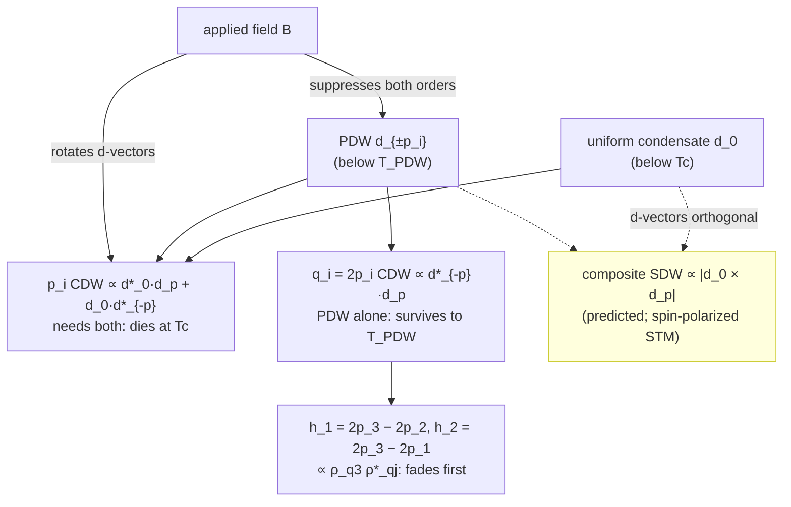
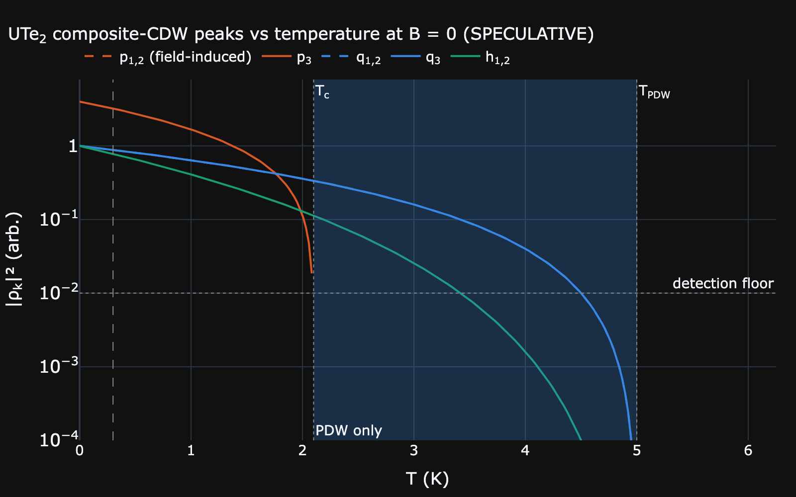
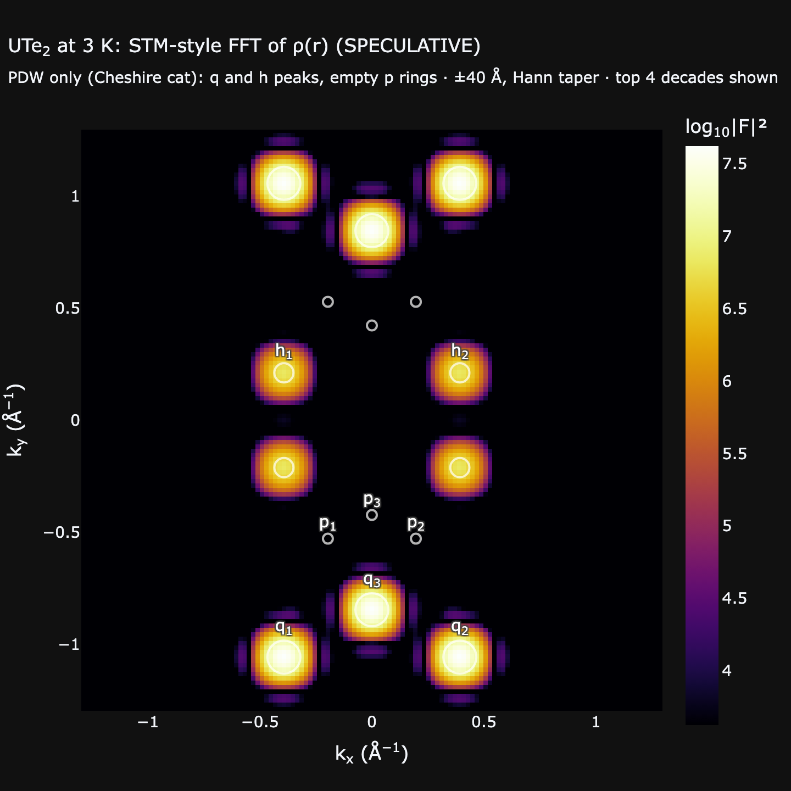
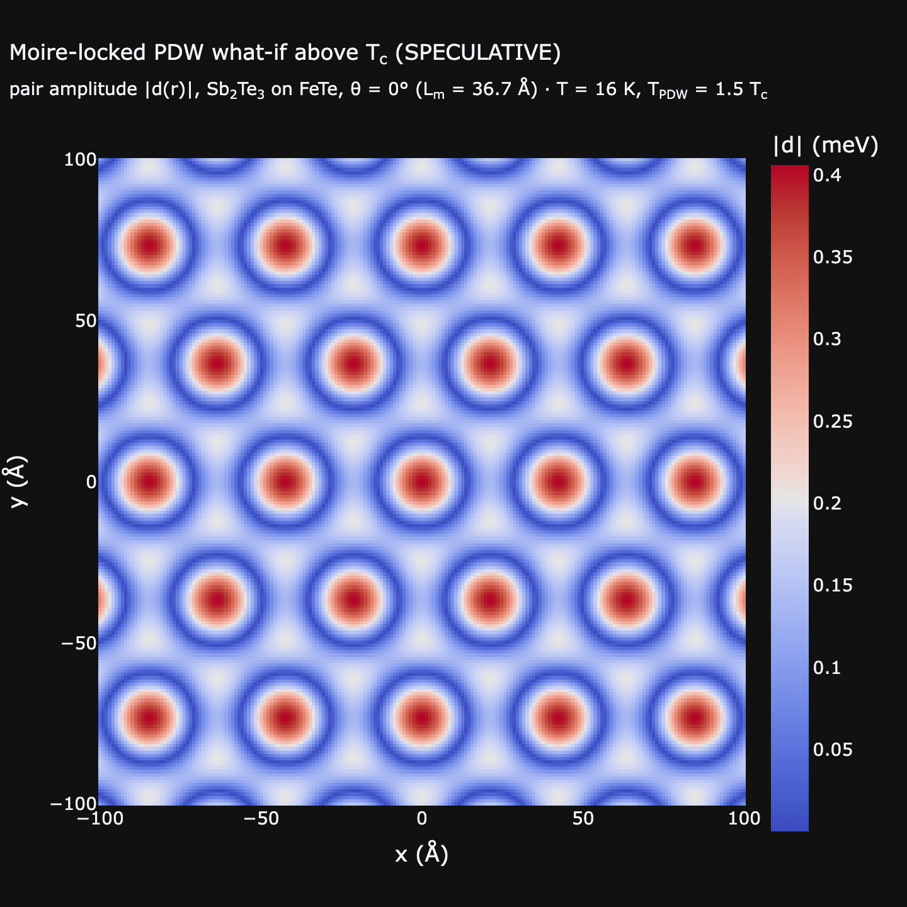

# Pair Density Waves and Their Composite Orders

[← Theory index](README.md) · [Documentation index](../README.md)

**Status: SPECULATIVE.** This module implements a phenomenological Landau model, not a microscopic theory. Its UTe2 defaults are tuned so that the visibility windows reported by vector-field STM ([Zhu et al. 2026](../references.md#ref-zhu-2026)) come out right; they are not a fit. The moire-locked geometry is a what-if for this repository's heterostructures. Every figure carries a `(SPECULATIVE)` tag. Treat the outputs as exploratory illustrations, not quantitative predictions.

## Overview

A **pair density wave (PDW)** is a superconductor whose Cooper pairs condense at finite centre-of-mass momentum $\pm\mathbf{p}$, so the pair amplitude itself oscillates in space. It differs from the [CPDM](gap-modulation.md#cpdm-versus-pdw) this project was built around. A CPDM is *imprinted* by the moire potential and vanishes with the uniform gap. A PDW breaks translation symmetry *spontaneously*, so it can have its own onset temperature $T_{PDW}$.

[Zhu et al. (PNAS 2026)](../references.md#ref-zhu-2026) used a vector-magnet STM on ultraclean UTe2 ($T_c \approx 2.1$ K) to resolve two families of non-dispersive charge density waves (CDWs):

- The **$\mathbf{p}_i$ peaks** vanish at $T_c$; $\mathbf{p}_{1,2}$ appear only in a magnetic field.
- The **$\mathbf{q}_i = 2\mathbf{p}_i$ peaks** survive to about 5 K, well above $T_c$. Their critical fields follow the same anisotropy as the upper critical field, $H^{b^*} > H^{c^*} > H^{a}$.

That field anisotropy is the evidence that the $\mathbf{q}_i$ order is tied to *pairing*, even though there is no uniform superconductivity above $T_c$. Eduardo Fradkin's line in the [press coverage](../references.md#ref-zhu-2026) is "Pair density waves are the Cheshire Cat's grin of superconductivity": the charge order is the grin that remains after the cat (the uniform condensate) is gone.

The app shows this physics on the web page `/pdw` (`src/waytogocoop/pages/pair_density_wave.py`) and in the desktop **Pair Density Wave** tab (`crates/moire-desktop/src/ui/pdw_panel.rs`, `ui/viewport.rs`). Both are built on the same model in `src/waytogocoop/computation/pdw.py` and `crates/moire-core/src/pdw.rs`.

## Model

### Landau free energy

The model is Eq. (1) of Zhu et al. In it, $\mathbf{d}_0$ is the d-vector of the uniform triplet condensate, $\mathbf{d}_{\pm\mathbf{p}_i}$ are those of the PDW components ($i = 1, 2, 3$), and $\rho_{\mathbf{k}}$ are the CDW amplitudes:

$$
\begin{aligned}
\mathcal{F} ={}& \sum_i \Big[\alpha_i (T - T_{PDW})\,|\mathbf{d}_{\mathbf{p}_i}|^2 + \lambda_i |\mathbf{d}_{\mathbf{p}_i}|^4\Big]
  + \alpha_0 (T - T_c)\,|\mathbf{d}_0|^2 + \lambda_0 |\mathbf{d}_0|^4 \\
&+ r_1 \sum_i |\rho_{\mathbf{p}_i}|^2 + r_2 \sum_i |\rho_{2\mathbf{p}_i}|^2
  + r_4\big(|\rho_{2\mathbf{p}_3 - 2\mathbf{p}_2}|^2 + |\rho_{2\mathbf{p}_3 - 2\mathbf{p}_1}|^2\big) \\
&+ \Big\{ g_1 \sum_i \rho_{\mathbf{p}_i}\big[\mathbf{d}_0\cdot\mathbf{d}^*_{\mathbf{p}_i} + \mathbf{d}^*_0\cdot\mathbf{d}_{-\mathbf{p}_i}\big]
  + g_2 \sum_i \rho_{2\mathbf{p}_i}\,\mathbf{d}_{-\mathbf{p}_i}\cdot\mathbf{d}^*_{\mathbf{p}_i} \\
&\quad + \gamma_1 \sum_i \rho_{\mathbf{p}_i}^2 \rho^*_{2\mathbf{p}_i}
  + \gamma_2\big[\rho_{2\mathbf{p}_3}\rho^*_{2\mathbf{p}_2}\rho^*_{2\mathbf{p}_3-2\mathbf{p}_2}
  + \rho_{2\mathbf{p}_3}\rho^*_{2\mathbf{p}_1}\rho^*_{2\mathbf{p}_3-2\mathbf{p}_1}\big] + \text{c.c.}\Big\}
\end{aligned}
$$

Every term conserves momentum. The paper leaves out the biquadratic (competition) terms and quenched disorder, and so does this module.

### Composite orders

Setting $\partial\mathcal{F}/\partial\rho^*_{\mathbf{k}} = 0$ gives $\rho_{\mathbf{k}} = -(\text{source})^*/r$ to leading order in the cubic couplings. With normalized amplitudes $\delta_0 = |\mathbf{d}_0(T,B)|/|\mathbf{d}_0(0)|$ and $\delta_p = |\mathbf{d}_p(T,B)|/|\mathbf{d}_p(0)|$, d-vector overlaps $c_i = \hat{\mathbf{d}}_0\cdot\hat{\mathbf{d}}_{\mathbf{p}_i}$ and sliding phases $\varphi_i$, `compute_pdw_state` evaluates:

| Family | Wavevector | Amplitude | Exists when | Paper's Table 1 |
|---|---|---|---|---|
| p | $\mathbf{p}_i$ | $\rho_{\mathbf{p}_i} = -2\kappa_p\,\delta_0\delta_p\,c_i\,e^{i\varphi_i}$ | PDW **and** uniform SC | Fundamental (low T) |
| q | $2\mathbf{p}_i$ | $\rho_{2\mathbf{p}_i} = -\kappa_q\,\delta_p^2\,e^{2i\varphi_i} - \kappa_{harm}\,\rho_{\mathbf{p}_i}^2$ | PDW alone suffices | Fundamental (high T) |
| h | $2\mathbf{p}_3 - 2\mathbf{p}_j$ | $\rho_{\mathbf{h}} = -\kappa_h\,\rho_{2\mathbf{p}_3}\rho^*_{2\mathbf{p}_j}$ | wherever q exists (∝ $\delta_p^4$) | Harmonic-derived |
| SDW (spec.) | $\mathbf{p}_i$ | $S_{\mathbf{p}_i} = 2\kappa_p\,\delta_0\delta_p\,\sqrt{1-c_i^2}\,e^{i\varphi_i}$ | d-vectors not parallel | predicted, not measured |

The normalized couplings absorb the gap scales: $\kappa_p = g_1|\mathbf{d}_0(0)||\mathbf{d}_p(0)|/r_1$, $\kappa_q = g_2|\mathbf{d}_p(0)|^2/r_2$, $\kappa_h = \gamma_2/r_4$, $\kappa_{harm} = \gamma_1/r_2$. That makes every $\rho$ dimensionless. STM measures the intensity $|\rho_{\mathbf{k}}|^2$. A peak counts as **visible** when it exceeds the detection floor (default 0.01). The real-space fields are:

- Pair amplitude: $|\mathbf{d}(\mathbf{r})|$ with $\mathbf{d}(\mathbf{r}) = \Delta_0\hat{\mathbf{n}}_0 + \sum_i 2\Delta_p\hat{\mathbf{n}}_i\cos(\mathbf{p}_i\cdot\mathbf{r} + \varphi_i)$. For a unitary triplet this is the local gap.
- Charge density: $\rho(\mathbf{r}) = \sum_{\mathbf{k}} 2\,\mathrm{Re}[\rho_{\mathbf{k}} e^{i\mathbf{k}\cdot\mathbf{r}}]$.
- Spin density: $S_z(\mathbf{r})$, built the same way from the $S_{\mathbf{p}_i}$.

### Mean-field amplitudes and field suppression

Each order follows the Landau minimum with a linear Ginzburg-Landau field term:

$$
\delta^2 = \max\!\big(0,\; 1 - T/T^* - h\big), \qquad
h = \sqrt{\textstyle\sum_n (B_n / H^*_n)^2},
$$

Here $T^*$ is $T_c$ for the uniform order or $T_{PDW}$ for the PDW, and $H^*_n$ are the zero-temperature critical fields along the magnet axes $n = x, y, z$. For UTe2 those axes are $x \approx c^*$, $y = a$, $z \approx b^*$, following the paper's vector-magnet frame. The ellipsoidal form is the usual effective-mass anisotropy. Along a unit direction $\hat{\mathbf{u}}$ it gives a critical field $H^*(T) = (1 - T/T^*)\big/\sqrt{\sum_n (u_n/H^*_n)^2}$ (`critical_field_along`). Field and temperature therefore close each phase along a straight line. That is why the regime map in the app is made of straight-sided wedges.

### Field-induced d-vector rotation

Zhu et al. explain the field-induced $\mathbf{p}_{1,2}$ peaks this way. At zero field $\mathbf{d}_{\mathbf{p}_{1,2}} \perp \mathbf{d}_0$, so $\rho_{\mathbf{p}_{1,2}} = 0$, while $\mathbf{p}_3$ is aligned. A field rotates the d-vectors into partial alignment. The module models this phenomenologically (`dvector_overlaps`):

$$
\sin\theta_i(B) = \sin\theta_i(0)\cdot\min\!\big(1,\ 1/h_{rot}\big), \qquad
h_{rot} = \sqrt{\textstyle\sum_n (B_n / H_{rot,n})^2}.
$$

Above the onset ($h_{rot} > 1$) an initially orthogonal pair reaches $c = \sqrt{1 - 1/h_{rot}^2}$. That is a Landau-like $\sqrt{h - 1}$ rise that saturates at full alignment. Because $|\rho_{\mathbf{p}}|^2 + |S_{\mathbf{p}}|^2 = (2\kappa_p\delta_0\delta_p)^2$, the rotation *converts* the predicted spin-density-wave weight into p-CDW weight.

### Regimes

| Regime | $\delta_0$ | $\delta_p$ | Visible charge order |
|---|---|---|---|
| Normal | 0 | 0 | none |
| **PDW only (Cheshire cat)** | 0 | > 0 | q and h only |
| Uniform SC only | > 0 | 0 | none (field killed the PDW first) |
| PDW + uniform SC | > 0 | > 0 | p, q, h (plus field-induced p1, p2) |

`regime_map` evaluates these on a $(|B|, T)$ grid along any field direction.

### UTe2 wavevectors and the h₂ sign

Zhu et al. quote $\{\mathbf{h}_1, \mathbf{h}_2, \mathbf{p}_3\} = \{(-0.26, 0.14), (0.26, -0.14), (0, -0.28)\}\,|q_{Te}|$, with $\mathbf{p}_i = \mathbf{q}_i/2$, $\mathbf{h}_1 = \mathbf{q}_3 - \mathbf{q}_2$ and $\mathbf{h}_2 = \mathbf{q}_3 - \mathbf{q}_1$. As printed, $\mathbf{h}_2 = -\mathbf{h}_1$. That would make $\mathbf{h}_1$ and $\mathbf{h}_2$ the same density wave, and the implied $\mathbf{p}_1$ and $\mathbf{p}_2$ would not be the mirror partners the paper describes. The mirror-consistent choice $\mathbf{h}_2 = (0.26, +0.14)$ fixes both problems, and it closes the hexagonal triple exactly ($\mathbf{h}_1 + \mathbf{h}_2 + \mathbf{p}_3 = 0$). The module uses it (`config.P_VECTORS_UTE2_QTE`, with $|q_{Te}| = 2\pi/4.16$ Å):

| Peak | units of $\lvert q_{Te}\rvert$ | λ = 2π/\|k\| |
|---|---|---|
| p₁, p₂ | (∓0.13, −0.35) | 11.2 Å |
| p₃ | (0, −0.28) | 14.9 Å |
| q₁, q₂ | (∓0.26, −0.70) | 5.6 Å |
| q₃ | (0, −0.56) | 7.4 Å |
| h₁, h₂ | (∓0.26, +0.14) | 14.1 Å |

### Calibration against the experiment

Six sets of inputs are tuned to the paper, and everything else follows from them: $T_c$, $T_{PDW}$, the three PDW critical fields, the three rotation onsets, $\kappa_p$ and the detection floor (1% of the zero-temperature q intensity, which sets the onset temperatures). Only the uniform-SC $H_{c2}$ triple is a literature estimate.

| Observation (Zhu et al.) | Model (`tests/test_pdw.py::TestZhuObservations`) |
|---|---|
| p₃ vanishes at $T_c$ = 2.1 K | visible at 2.0 K, gone by 2.15 K |
| h₁,₂ vanish near 3.5 K | drop below the floor at 3.42 K |
| q visible at 4.2 K, markedly reduced by 4.8 K | visible at 4.2 K, below the floor from 4.5 K |
| q suppressed at 4.2 K between 1.5–3.0 T (c\*), 0.4–0.8 T (a), 4–8 T (b\*) | PDW critical fields 2.24, 0.60, 6.0 T (mid-window by construction) |
| $H_{sup}$ hierarchy b\* > c\* > a mirrors $H_{c2}$ | same ordering in both |
| p₂ appears at ≈ 0.5 T (a, c\*) and 5 T (b\*) at 300 mK | absent at 0.3 T / 4 T, present at 0.5 T / 5 T |
| at 1.6 K along b\*: p₂ at 5–6 T, gone at 8 T; nothing at 2.5 K | same |
| along c\*: p₂ strengthens up to 2 T, weaker at 3 T | same |

**Known gap:** the measured h peaks are more field-sensitive than the model's. At 2.5 K, h₂ is gone by 0.5 T along a in the data, while the model keeps it to about 0.7 T. At 1.6 K and 8 T along b\*, h₁,₂ are gone in the data but still above the floor in the model. A biquadratic h–SC competition term, which the paper also leaves out, would be the natural place to add this.

*`pdw-tsweep` — zero-field intensities $|\rho_{\mathbf{k}}|^2$ on a log axis. p₃ (orange) dies at $T_c$. q (blue) and h (aqua) survive into the shaded PDW-only window, and h falls below the detection floor first.*

*`pdw-fft` — Hann-tapered FFT of $\rho(\mathbf{r})$ at 3 K. The q and h peaks are bright, while the open rings at $\pm\mathbf{p}_i$ sit on empty background: the Cheshire-cat signature.*

### The moire-locked what-if

`moire_locked_config` (Python) and `PdwConfig::moire_locked` (Rust) place three PDW wavevectors of magnitude $2\pi/L_m$ at 120° and rotate them with the twist, so this is the CPDM written in PDW language. The three-fold set follows the hexagonal overlayers. It is an assumption: on the square FeTe substrate the moire itself is not C3.

$L_m$ comes from the two-lattice formula `moire_locked_period`, shared by both stacks:

$$
L_m = \frac{a_1 a_2}{\sqrt{a_1^2 + a_2^2 - 2 a_1 a_2 \cos\theta}}.
$$

It is exact in both limits ($a_1 a_2/|a_1 - a_2|$ at $\theta = 0$, and $a/(2\sin(\theta/2))$ for equal lattices). The viewers' own period estimates are not used, because they disagree between the stacks at nonzero twist: the web takes the twist formula with $a_{eff}$, the desktop the smaller of the two formulas. For FeTe/Sb2Te3 at 1°, the shared formula gives 36.2 Å, the mismatch-dominated answer.

The amplitude comes from `moire_locked_pdw_ratio`. Half the two-gap split $(\Delta_2 - \Delta_1)/2$ goes to each of $\pm\mathbf{Q}$, relative to the mean gap, times the CPDM suppression $e^{-\xi/L_m}$.

The preset uses the FeTe-film $T_c$ = 13.5 K ([Yan et al. 2026](../references.md#ref-yan-2026)), isotropic $B_{c2}$ = 47 T and aligned (singlet-like) d-vectors.

The preset sets $T_{PDW} = T_c$. An imprinted CPDM has no Cheshire-cat window, so every composite order vanishes at $T_c$ (`TestMoireLocked`). Raising $T_{PDW}/T_c$ above 1 turns the preset into a falsifiable question for these heterostructures: what if the moire-period pair modulation were an intrinsic PDW? Above $T_c$ the answer has two parts:

- The charge order **halves its period**: only the $2\mathbf{Q}_m$ and h harmonics remain.
- The pair amplitude develops a lattice of **nodes** where pairing vanishes.

A temperature-dependent STM map of the $2\mathbf{Q}_m$ peak across $T_c$ would tell the two pictures apart.

*`pdw-moire-whatif` — FeTe/Sb2Te3 at 16 K with $T_{PDW} = 1.5\,T_c$. The red rings are nodes of $|\mathbf{d}(\mathbf{r})|$. The desktop scene `rust-pdw-whatif-3d` shows the same field as a surface.*

## Assumptions and validity

- **Mean field, leading order.** Amplitudes come from the decoupled quadratic-plus-quartic Landau terms. The CDWs are first-order responses to their sources, with no back-reaction of $\gamma_{1,2}$ on the amplitudes and no fluctuations. A fluctuating, vestigial PDW without long-range order is outside the model.
- **Linear GL laws extrapolated to T = 0.** $\delta^2 \propto 1 - T/T^* - h$ is the Landau form near the transition. It is qualitative deep in the ordered phase, and it gives straight phase boundaries rather than the curved $H_{c2}(T)$ of real materials.
- **Critical-field definition.** The model identifies the paper's $H_{sup}$ with the PDW mean-field critical field, where q vanishes identically. At 4.2 K that is $0.16\,H^*_n$. With the 1% floor, q drops out of view earlier, at about $0.06\,H^*_n$.
- **Surface versus bulk.** Zhu et al. note that a PDW above the bulk $T_c$ must be surface-localized. Resonant X-ray scattering finds no bulk CDW in the normal state ([Kengle et al. 2024](../references.md#ref-kengle-2024)). The model is 2D and makes no claim about the bulk.
- **Approximate inputs.** The uniform-SC $H_{c2}$ triple (20, 11, 34 T) is a literature estimate (see `config.HC2_UTE2`). The ratio $\Delta_p(0)/\Delta_0(0)$ = 0.3 is illustrative and only affects the pair-amplitude map. The field axes $c^*$ and $b^*$ sit about 12° off the crystal axes for the (01-1) cleave.

## Speculative components

All of it, but in increasing order of speculation:

1. The composite-order structure ($\rho_{\mathbf{p}}$, $\rho_{2\mathbf{p}}$, $\rho_{\mathbf{h}}$) is the paper's Landau theory.
2. Its quantitative calibration is this module's own choice.
3. The d-vector rotation law is a phenomenological interpolation of the paper's qualitative statement.
4. The composite **SDW** is the paper's prediction, with an unknown coefficient. The module carries it with the p-CDW coupling. For a time-reversal-symmetric (Larkin-Ovchinnikov) pairing of $\pm\mathbf{p}$, the two symmetry-related contributions $\mathbf{d}_0\times\mathbf{d}^*_{-\mathbf{p}}$ and $\mathbf{d}_{\mathbf{p}}\times\mathbf{d}^*_0$ cancel. The model's own pair field has exactly this form ($\mathbf{d}_{-\mathbf{p}} = \mathbf{d}^*_{\mathbf{p}}$), so the symmetric expression vanishes. $S_z(\mathbf{r})$ keeps the paper's single term $\mathbf{d}_0\times\mathbf{d}^*_{\mathbf{p}}$ instead. Read it as a different assumption that shows where spin-polarized STM would look, not as a prediction or a bound.
5. The moire-locked geometry with $T_{PDW} > T_c$ is a hypothetical with no experimental basis yet.

## Implementation

| Concept | Python (`src/waytogocoop/`) | Rust (`crates/`) |
|---|---|---|
| UTe2 / FeTe-film constants | `config.py` PDW block (`TC_UTE2`, `H_PDW_UTE2`, `P_VECTORS_UTE2_QTE`, `PDW_KAPPA_*`, …) | `moire-core/src/pdw.rs` constants (`TC_UTE2`, `H_PDW_UTE2`, `KAPPA_*_DEFAULT`, …) |
| Wavevectors | `computation/pdw.py`: `ute2_wavevectors`, `moire_locked_wavevectors`, `harmonic_vectors` | same names |
| Amplitudes and fields | `landau_amplitude`, `reduced_field`, `critical_field_along`, `onset_field_along` | same names (returning `Result`) |
| d-vector rotation | `dvector_overlaps` | `dvector_overlaps` |
| State and composites | `compute_pdw_state` → `PdwState` | `compute_pdw_state` → `PdwState` (`Complex64` amplitudes) |
| Peaks | `pdw_peaks` → `PdwPeak` | `pdw_peaks` → `PdwPeak` (`PdwFamily`) |
| Real space | `pdw_fields_at`, `pdw_real_space(config, state, x, y)` | `pdw_fields_at`, `pdw_real_space(cfg, state, n, extent)` |
| Sweeps and regimes | `temperature_sweep`, `field_sweep` → `PdwSweep`; `classify_regime`, `regime_map` | same (`PdwRegime` enum, row-major map) |
| Moire-locked preset | `moire_locked_config`, `moire_locked_period`, `moire_locked_pdw_ratio` | `PdwConfig::moire_locked`, `moire_locked_period`, `moire_locked_pdw_ratio` |
| STM-style spectrum | `charge_spectrum` (own 256² grid, Hann taper, padded to 1024², cropped to the peaks) | `compute_fft_2d` on the Hann-tapered display grid (`app.rs`) |
| UI | `pages/pair_density_wave.py`, `components/pdw_panel.py`, `figure_factory.create_pdw_*` | `moire-desktop/src/app.rs` (`PdwSettings`, `PdwView`, `recompute_pdw`), `ui/pdw_panel.rs`, `ui/viewport.rs` |

**Cross-stack parity anchors**, asserted to $10^{-12}$ in both `tests/test_pdw.py::TestCrossStackParityAnchors` and the `test_parity_*` tests in `pdw.rs`:

- $H_{sup}(4.2\ \text{K})$ = 2.24 / 0.60 / 6.00 T along $c^*$ / $a$ / $b^*$.
- $|\rho_{\mathbf{p}_2}|$ = 0.963907488848813 at 0.3 K and $B_z$ = 6 T.
- At the origin for the defaults (0.3 K, zero field): $|\mathbf{d}|$ = 0.607885168114487 meV, $\rho$ = −12.764863559406859, $S_z$ = 7.180927118813718.
- Moire-locked FeTe/Sb2Te3 at a 1° twist (4 K, default gaps, ξ = 20 Å): $L_m$ = 36.23263757853417 Å, ratio = 0.047517778919214, origin $|\mathbf{d}|$ = 3.331137631734327 meV, $\rho$ = −14.647462277091908.

The two grids differ by convention. Python takes explicit axes (the page uses $x \in [-L, L]$), while Rust spans $[-L/2, L/2]$ like the other `moire-core` grids. The anchors are therefore point evaluations. The STM-style FFT applies a Hann taper, because incommensurate peaks would otherwise leak into streaks along $k_x$ and $k_y$. The web page also zero-pads a fixed 256² resampling and crops to the peak region, so its k-resolution and payload do not grow with the display grid.

## References

- [Zhu et al., PNAS 123, e2602117123 (2026)](../references.md#ref-zhu-2026) — the vector-field STM data and the Landau free energy implemented here.
- [Agterberg et al., Annu. Rev. Condens. Matter Phys. 11, 231 (2020)](../references.md#ref-agterberg-2020) — review of PDW physics and its composite orders.
- [Fradkin, Kivelson & Tranquada, Rev. Mod. Phys. 87, 457 (2015)](../references.md#ref-fradkin-2015) — intertwined orders.
- [Aishwarya et al., Nature 618, 928 (2023)](../references.md#ref-aishwarya-2023) and [Gu et al., Nature 618, 921 (2023)](../references.md#ref-gu-2023) — the original field-sensitive CDW and PDW observations in UTe2.
- [Wu et al., PNAS 121, e2403067121 (2024)](../references.md#ref-wu-2024) and [Aoki et al., JPSJ 89, 053705 (2020)](../references.md#ref-aoki-2020) — the upper-critical-field estimates.
- [Kengle et al., Nat. Commun. 15, 9713 (2024)](../references.md#ref-kengle-2024) — no bulk CDW above $T_c$, so the PDW-only window is a surface phenomenon.
- Related theory pages: [gap modulation](gap-modulation.md) (the CPDM-versus-PDW distinction), [Fourier analysis](fourier-analysis.md) (FFT conventions), [magnetic field effects](magnetic.md) (vortex physics, which this model does not include).
